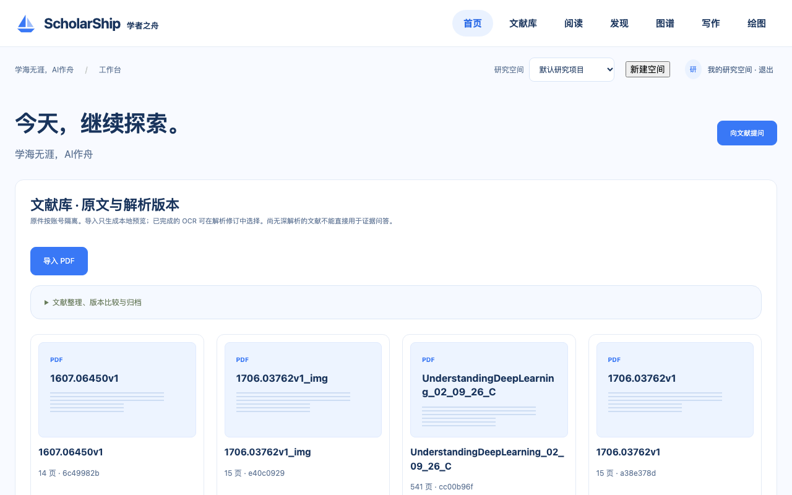
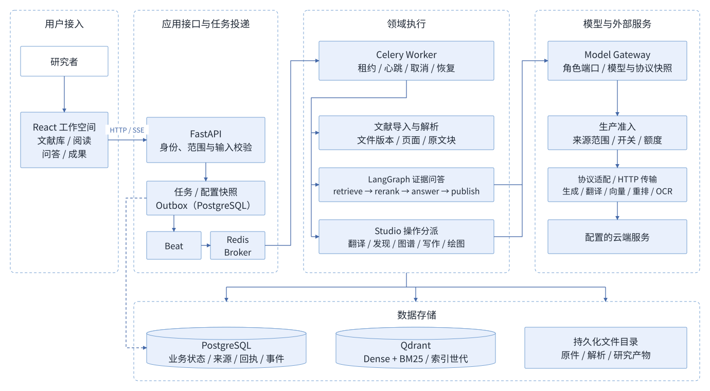
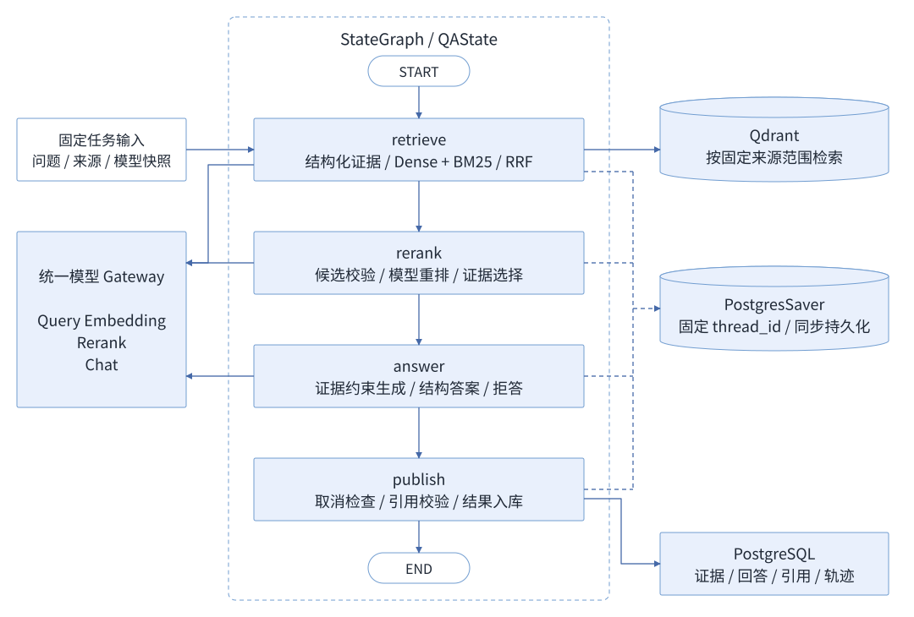
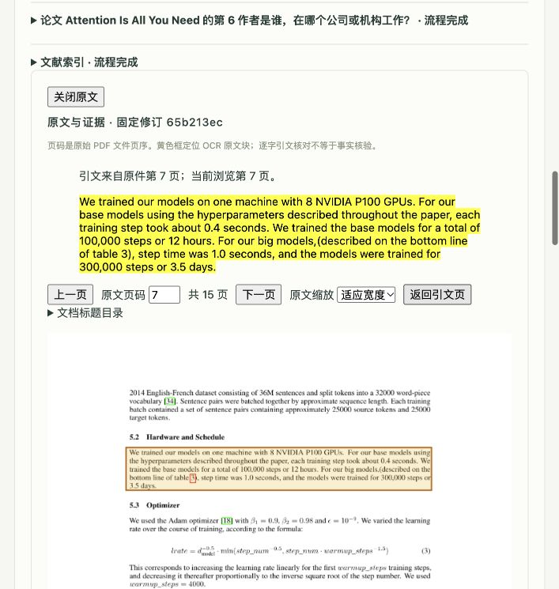

<p align="center">
  
</p>
<p align="center"><strong>Navigate research with AI. Keep every insight grounded.</strong></p>
<p align="center">
  
  
  
  
  
  <a href="#license"></a>
</p>
<p align="center"><a href="README.en.md">English</a> | <a href="README.md">简体中文</a></p>

**ScholarShip (学者之舟, “a scholar’s vessel”) is an AI research workspace for students and individual researchers.** Start with a PDF, then read, translate, ask questions and organize outputs in one place. Answer citations link back to the original, while translations and drafts retain sources and revision history.

The project connects papers, conversations and research notes through a traceable chain: **document version → parse revision → source passage → research artifact**. Follow that chain to check the material before using generated content.

<p align="center"><a href="#demo">Demo</a> · <a href="#features">Capabilities</a> · <a href="#architecture">Architecture</a> · <a href="#quickstart">Quickstart</a> · <a href="docs/guides/user-manual.md">User guide (Chinese)</a></p>

<a id="demo"></a>
## 36-second feature preview

<p align="center"><a href="docs/assets/demo-preview.mp4"></a></p>
<p align="center"><sub>36-second auto-looping preview · All waits removed · Click for the 36-second 1080p video</sub></p>

[36-second HD preview](docs/assets/demo-preview.mp4) · [Detailed walkthrough (90 seconds)](docs/assets/demo.mp4) · [Start-to-finish guide (Chinese)](docs/guides/first-research-session.md) · [Captions](docs/assets/demo.srt) · [Chapter timestamps](docs/assets/demo-chapters.json)

Each feature appears once, in use order: **workspace → PDF import → local parsing → indexing and QA → citation checks → bilingual reading → discovery and graphs → writing → charts and exports → saved results**. Waiting, debugging and repeated navigation have been removed; the key actions and completed results remain.

Recorded from the real interface at 1920×1080 and 25 fps, with Chinese step captions. New QA and writing tasks use explicitly labelled simulation; real answers and translations are historical results. No new cloud inference, OCR or full-text upload was made. Crossref receives only the public search query.

<a id="features"></a>
## Capabilities

A typical session: import papers on a topic, ask within a selected source scope and inspect citations in the PDF. Revise a translation alongside the original, then save summaries, research leads and charts as outputs you can revisit.

| Capability | Main operations | Sources and artifacts |
|---|---|---|
| Library and parsing | Batch-import PDFs, review duplicate candidates, manage versions and extract text structure | File hashes, immutable parse revisions, pages and source blocks |
| Retrieval and evidence QA | Ask within 1–8 selected document versions and follow citations to the original | Dense + BM25 retrieval, reranking, fixed source scope and abstention when evidence is missing |
| Bilingual reading | Read PDFs, translate selections or documents, compare languages, revise and export | Formula/code literal protection, segment caching and translation versions |
| Discovery and tracking | Search arXiv / Crossref metadata, subscribe, record feedback and review paper identity | Permitted-source downloads, identity-candidate review and tracking records |
| Citation graphs and research leads | Inspect local citation graphs, prepare source summaries and direction drafts, check follow-up evidence | Candidate-edge labels, local PageRank, source manifests and manual review |
| Writing and reproducible charts | Prepare summaries and outlines; generate CSV-based charts and Mermaid graphs from nodes and edges | Draft versions; exports of data, images, settings and Python scripts |

Use the tools independently as needed. **Evidence QA requires a ready parse and index; translation, writing and CSV plotting do not require QA or indexing first.** Local previews, text-layer extraction, graph calculations and controlled plotting need no model key. Public metadata search uses the network. Model generation requires service configuration and execution admission.

<a id="architecture"></a>
## Architecture

ScholarShip is a **React + FastAPI modular monolith**. API, Celery Worker and Beat run as separate processes over shared domain code. PostgreSQL holds authoritative business state, Redis delivers messages, Qdrant stores rebuildable search indexes, and persistent file storage holds originals and artifacts.



### Evidence QA workflow

LangGraph runs four nodes: **retrieve → rerank → answer → publish**. Each task pins its sources and model configuration; node state is persisted through PostgreSQL checkpoints. Deterministic author-order and table-calculation tools can supply results within those nodes. Translation, graphs and writing use Studio operation dispatch.



Key design choices:

- **Preserve sources with their versions.** Citations bind document versions, parse revisions and source spans. Reparsing preserves historical answer sources.
- **Make long-running work traceable.** An outbox records delivery intent, workers use leases and heartbeats, and SSE exposes persisted task events. Checkpoints and external-call receipts are separate; unknown outcomes require reconciliation before recovery.
- **Use a shared model boundary.** `model_config.py` and the Gateway manage roles, protocols, snapshots and admission. Embedding changes create new index generations; real and simulated profiles stay separate.
- **Enforce isolation in the data layer.** Tenant transactions set `app.owner_id`, backed by RLS and ownership constraints. Retrieved candidates are checked against PostgreSQL sources before becoming evidence.

[Architecture details](docs/engineering/architecture-current.md) · [Other views and editable sources](docs/engineering/architecture-gallery.md) · [Code walkthrough](docs/engineering/code-walkthrough.md) · [Model adapter design](docs/models/adapter-design.md) — diagrams and supporting guides are in Chinese.

<a id="quickstart"></a>
## Quickstart

### 1. Prepare the environment

The verified development environment is **macOS Apple Silicon, Python 3.12 and Docker Desktop**. Start Docker Desktop first. Bootstrap prepares project-specific Python, Node and pnpm tooling. Windows / Linux bootstrap has not been validated; see [deployment notes](docs/guides/deployment.md) for other run modes.

```bash
git clone https://github.com/JingleiCui/ScholarShip.git
cd ScholarShip
python3.12 --version
docker compose version
```

### 2. Initialize

Set `BOOTSTRAP_PYTHON` near the top of `bootstrap.py` to your Python 3.12 executable (`command -v python3.12`), then run:

```bash
python3.12 bootstrap.py
```

Bootstrap generates a private `.env` and initial accounts, prepares the infrastructure containers and applies database migrations. Existing configuration and data are retained. **Do not copy an empty `.env.example` before the first run or overwrite an existing `.env` with the template.** Keep `EXTERNAL_SERVICES_ENABLED=false` for the first session; no model key is needed.

### 3. Start and log in

```bash
.venv/bin/python dev.py
```

Open **http://127.0.0.1:15173**. Log in as `researcher` with `INITIAL_USER_PASSWORD` from your local `.env`. API docs: [http://127.0.0.1:18080/docs](http://127.0.0.1:18080/docs). Local and container application modes are mutually exclusive; do not run duplicate Workers or Beat processes.

### 4. Read your first paper

1. Create a research workspace and import PDFs you have permission to use in Library. A fresh clone includes no developer corpus, indexes or model quota.
2. Select a paper and open Reading. Inspect the original, then extract text structure locally when needed. Scans need OCR; text-layer extraction does not replace it.
3. Choose a tool: build an index for QA, configure models for translation or writing, or run CSV plotting locally.
4. Reopen saved answers, translations, summaries and charts in Results. Check their citations and source labels against the material.

| Execution mode | Purpose | Requirements |
|---|---|---|
| Local tools | Import, previews, text structure, graph calculations and controlled charts | No model key |
| Simulation (mock) | Explore retrieval, QA and translation in a separate practice workspace | Outputs retain simulation labels and are not research conclusions |
| Cloud providers | Real generation, embeddings, reranking and translation | [Model configuration and production admission](docs/guides/models.md) |

Stop local application processes while retaining infrastructure and data:

```bash
.venv/bin/python stop.py
```

[Installation details](docs/guides/getting-started.md) · [Full user guide](docs/guides/user-manual.md) · [Troubleshooting](docs/runbook.md)

## Project structure

```text
ScholarShip/
├── frontend/src/                # Navigation, PDF reading, citations and task UI
├── backend/
│   ├── src/scholarship/
│   │   ├── api/                 # HTTP, sessions, request validation and SSE
│   │   ├── domains/             # Documents, parsing, retrieval, QA and Studio
│   │   ├── models/              # Catalog, protocols, transports, gateway and admission
│   │   ├── infrastructure/      # Database, storage and service integration
│   │   └── workers/             # Background execution, delivery and scheduling
│   ├── migrations/             # Forward Alembic migrations
│   └── tests/                  # Contract and integration tests
├── deploy/                     # Containers and reverse proxy
├── docs/                       # Usage, architecture, models and development
├── model_config.py             # Unified model configuration
├── bootstrap.py                # Environment initialization
├── dev.py / stop.py             # Local application lifecycle
└── doctor.py / validate.py      # Diagnostics and engineering checks
```

## Validation and boundaries

**Answer → cited passage → original PDF location**



This historical screenshot shows training hardware and timing on page 7 of the Transformer paper, with the corresponding original passage highlighted. The [demo](#demo) shows citation navigation in the current UI. These illustrate source checks for this sample; they do not establish general answer accuracy.

| Validation layer | Existing records | Scope |
|---|---|---|
| Engineering regression | 234 backend tests, 12 frontend tests and a production build passed | Local workspace results from 2026-11-18, not remote CI status |
| Real model samples | Five fixed single-paper questions, scanned-paper indexing and translation artifacts | Completed bounded runs; general and multi-paper scientific quality still need independent evaluation |
| Content and tools | Separate checks for text-layer structure, source localization, simulation and controlled charts | No general OCR, automatic figure semantics or research novelty guarantee |

Cloud services are disabled by default. Simulated results, model drafts and unreviewed candidates retain their labels. Original papers, user databases and private receipts are not distributed with the source. See [capabilities and validation scope](docs/guides/capabilities.md) for details.

Local checks:

```bash
.venv/bin/python doctor.py
.venv/bin/python validate.py
```

Validation requires the infrastructure containers and uses isolated temporary databases, queues and vector collections. Reports live in `var/reports/` and are excluded from Git.

## Documentation and contributing

[Documentation](docs/README.md) · [Contributing](CONTRIBUTING.md) · [Security](SECURITY.md) · [AI-assisted development](docs/development/ai-assisted-development.md)

ScholarShip is developed by an individual. Reproducible issues and focused improvements are welcome. Do not include credentials, session cookies, private data or papers you cannot redistribute. Enabling external services sends relevant content to the selected providers.

<a id="license"></a>
## 📄 License

This project is licensed under the **GNU Affero General Public License v3.0 (AGPL-3.0)**.
See the root [LICENSE](LICENSE) for the full text.

Copyright (c) 2026 崔静蕾.

AGPL-3.0 permits copying, modification and redistribution, including commercial use. If you
modify the project and make it available to users over a network, you must offer the corresponding
source code under AGPL-3.0. The project is mainly intended for learning and exchange; please
honor the source-disclosure obligation when offering it as an online service.

Third-party components retain their respective licenses; see [THIRD_PARTY_NOTICES.md](THIRD_PARTY_NOTICES.md).
