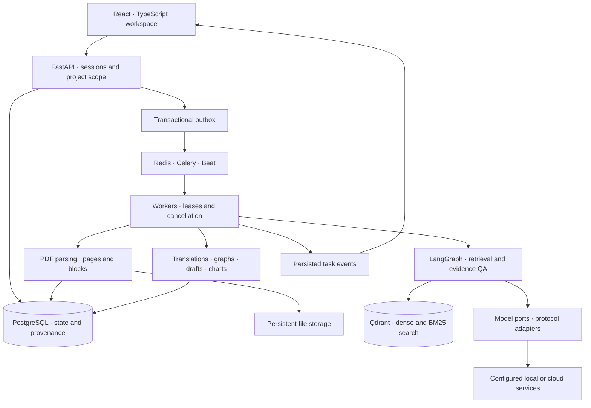

<p align="center">
  
</p>
<p align="center"><strong>Navigate research with AI. Keep every insight grounded.</strong></p>
<p align="center">
  
  
  
  <a href="#license"></a>
</p>
<p align="center"><a href="README.en.md">English</a> | <a href="README.md">简体中文</a></p>

**ScholarShip is an evidence-first AI research workspace.** Import papers, read and translate them, ask questions, explore citations, and turn findings into drafts and reproducible charts—with document versions and source locations preserved.


<sub>Actual local interface captures, condensed into a page-by-page preview. No new model requests were made. The UI is currently in Chinese; historical citation evidence appears below.</sub>

<p align="center"><a href="#quickstart">Quickstart</a> · <a href="docs/guides/user-manual.md">User guide (Chinese)</a> · <a href="docs/engineering/code-walkthrough.md">Code walkthrough (Chinese)</a> · <a href="docs/guides/models.md">Model configuration (Chinese)</a></p>

## ✨ Features

| Capability | What you can do | How it works |
|---|---|---|
| 📚 Library and versions | Batch-import PDFs, review duplicates, compare versions, archive and restore | File hashes, content identity signals, immutable parse revisions |
| 🔎 Evidence QA | Ask within a selected corpus and inspect citations in the original PDF | Dense + BM25 retrieval, reranking, citation validation, evidence-based abstention |
| 📖 Bilingual reading | Read PDFs, translate documents or selections, revise and export translations | Literal protection, segment caching, revision history |
| 🕸️ Connected literature | Search public metadata, review references, inspect local citation graphs | arXiv / Crossref, review overlays, PageRank |
| ✍️ Research and writing | Prepare source-linked summaries, outlines and research direction reviews | Frozen source scope, provenance manifests, artifact versions |
| 📊 Reproducible charts | Generate charts from CSV and export images, settings and scripts | Controlled plotting templates, explicit units and missing-value rules |
| 🔌 Model adapters | Configure generation, translation, embeddings, reranking and parsing separately | Protocol plugins, pinned task snapshots, independent embedding profiles |
| ⚙️ Background work | Follow progress, cancel tasks and recover interrupted work | Celery, transactional outbox, leases, persisted SSE events |

PostgreSQL is the source of truth; search indexes are derived and rebuildable. Citations remain tied to document and parse versions. Changing embedding models requires a new index generation before switching the active pointer. See the [architecture](docs/engineering/architecture-current.md) and [code walkthrough](docs/engineering/code-walkthrough.md) for implementation details.

> This is an actively developed personal project. Cloud inference requires configured services and admission policies. General local-model business dispatch is not implemented yet. Cross-paper QA, long-document parsing and translation quality need broader evaluation. See [capabilities and limits](docs/guides/capabilities.md); synthetic tests are not research-accuracy measurements.

## 🏗️ Architecture



SSE reports task steps, not model token streaming. Adapter boundaries describe the design; they do not imply that every local service is ready to run.

<a id="quickstart"></a>
## 🚀 Quickstart

### 1. Prerequisites

The verified development environment is **macOS Apple Silicon, Python 3.12 and Docker Desktop**. Start Docker Desktop first. Bootstrap prepares project-specific Python, Node and pnpm tooling without global upgrades. See [deployment notes](docs/guides/deployment.md) for container setup; other platforms have not been fully validated.

### 2. Install

```bash
git clone https://github.com/JingleiCui/ScholarShip.git
cd ScholarShip
python3.12 --version
docker compose version
```

Set `BOOTSTRAP_PYTHON` near the top of `bootstrap.py` to your Python 3.12 executable (`command -v python3.12`), then run:

```bash
python3.12 bootstrap.py
```

### 3. Configure

Bootstrap creates a private `.env` and random login passwords. Do not overwrite an existing configuration with the example file. Keep `EXTERNAL_SERVICES_ENABLED=false` for the first local session. Models and role assignments live in `model_config.py`.

| Mode | Purpose | Requirements |
|---|---|---|
| Local library and charts | Import, text-layer parsing, PDF reading and controlled charts | No model key |
| mock | Exercise retrieval, QA and translation workflows | Synthetic outputs, not research conclusions |
| Cloud providers | Real generation, embeddings, reranking and translation | [Service configuration and production admission](docs/guides/models.md) |
| local preset | Local-model integration development | Service setup and general business dispatch remain incomplete |

### 4. Run

```bash
.venv/bin/python dev.py
```

Open **http://127.0.0.1:15173**. Log in as `researcher` with `INITIAL_USER_PASSWORD` from your private `.env`. API docs: http://127.0.0.1:18080/docs.

1. Create a workspace and import a text-based PDF you have permission to use.
2. Wait for import, open its preview, then run text-structure parsing.
3. Check page numbers against the original. Scanned pages need OCR; an empty text layer is not successful OCR.
4. Use simulation mode to inspect QA workflow behavior. Real inference requires separate model admission.

Stop local application processes while retaining infrastructure and data:

```bash
.venv/bin/python stop.py
```

[Full user guide](docs/guides/user-manual.md) · [Installation](docs/guides/getting-started.md) · [Troubleshooting](docs/runbook.md) — supporting documentation is currently in Chinese.

## 📁 Project structure

```text
ScholarShip/
├── frontend/src/                 # Workspace, PDF reader, citations and task UI
├── backend/src/scholarship/
│   ├── api/                      # HTTP routes, sessions and request validation
│   ├── domains/                  # Documents, retrieval, QA and research artifacts
│   ├── models/                   # Catalog, protocols, transports and admission
│   ├── infrastructure/           # Database, storage and service integration
│   └── workers/                  # Background jobs and scheduling
├── backend/tests/                # Contract and integration tests
├── local_services/               # Optional local-service integration preparation
├── deploy/                       # Containers and reverse proxy
├── docs/                         # Usage, architecture and development guides
├── model_config.py               # Unified model and runtime configuration
├── bootstrap.py                  # Environment initialization
├── dev.py                        # Local application launcher
└── validate.py                   # Code, build and integration checks
```

## 🧪 Evidence and validation

**Answer → cited passage → original PDF location**


This historical screenshot shows training hardware and timing on page 7 of the Transformer paper, with the corresponding original PDF region highlighted. It uses an earlier UI. It demonstrates source localization for this sample, not universal answer correctness.

| Layer | Existing evidence | Scope |
|---|---|---|
| Engineering regression | 225 backend tests, 3 frontend tests and a production build | Local workspace results from 2026-11-17, not remote CI status |
| User workflow | Seven local steps using real PDFs | Synthetic QA and translation responses |
| Real model samples | Five single-paper questions, scanned-paper indexing and translation artifacts | Historical bounded runs; semantic review remains necessary |

Run checks locally:

```bash
.venv/bin/python doctor.py
.venv/bin/python validate.py
.venv/bin/python local_models_doctor.py
```

Validation requires the infrastructure containers and uses isolated temporary databases, queues and vector collections. Reports live in `var/reports/` and are excluded from Git. See the [validation record](docs/qa/completion-2026-11-17.md).

## Documentation and contributing

[Documentation](docs/README.md) · [Contributing](CONTRIBUTING.md) · [Security](SECURITY.md) · [AI-assisted development](docs/development/ai-assisted-development.md)

ScholarShip is developed by an individual. Reproducible issues and focused improvements are welcome. Do not include credentials, session cookies, private data or papers you cannot redistribute. Enabling external services sends the relevant text to the selected providers.

<a id="license"></a>
## 📄 License

**A project-wide license has not been selected.** This repository does not currently claim MIT, Apache-2.0 or another open-source license. Third-party components retain their respective licenses; see [THIRD_PARTY_NOTICES.md](THIRD_PARTY_NOTICES.md).
