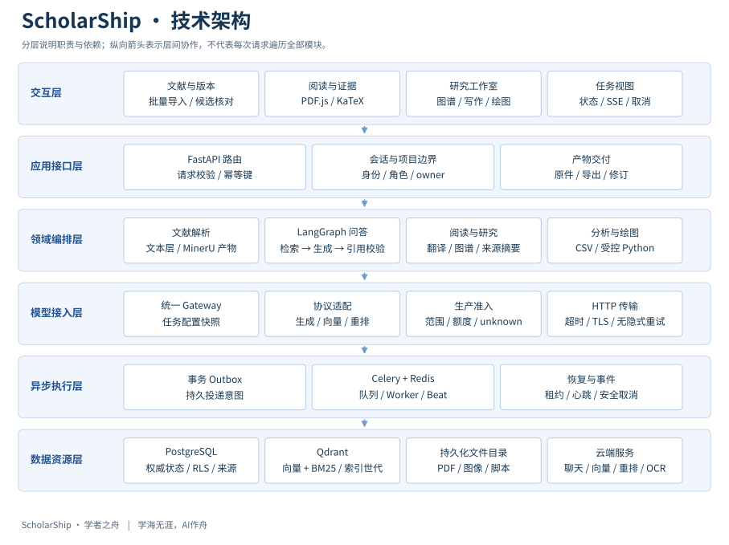
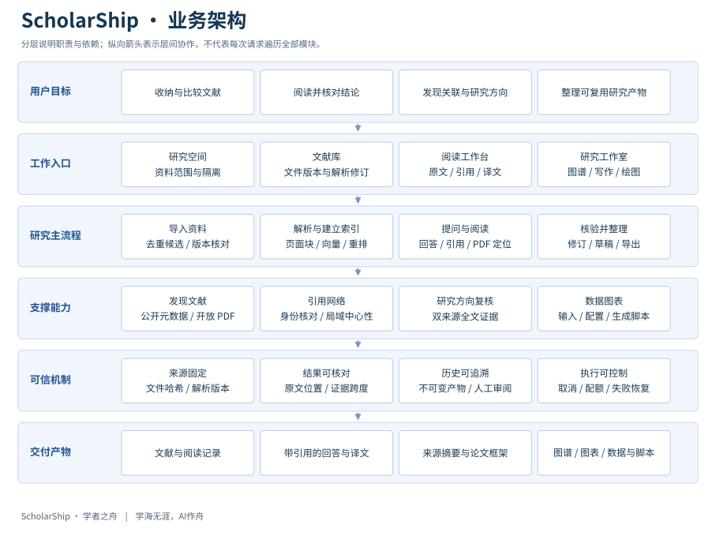
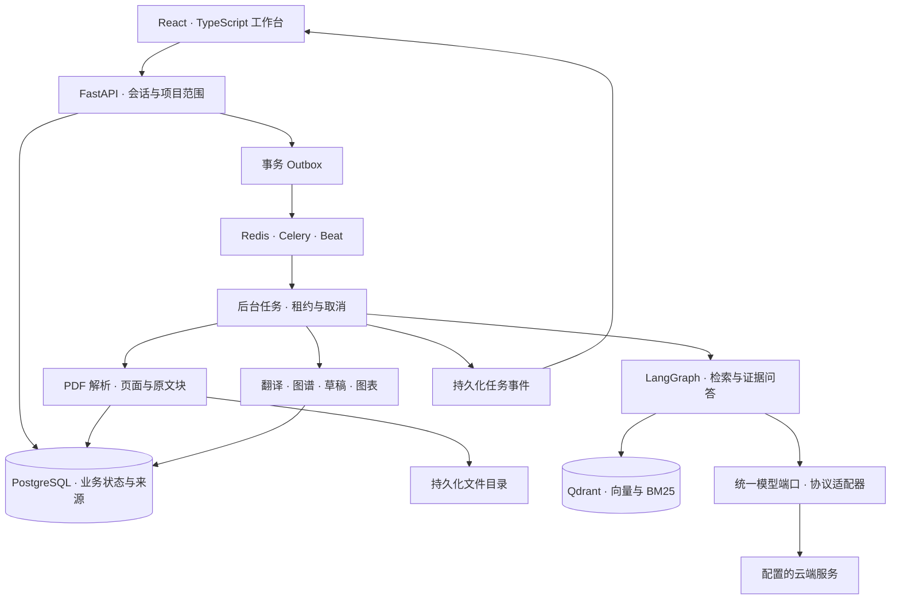

<p align="center">
  
</p>
<p align="center"><strong>学海无涯，AI作舟。</strong></p>
<p align="center">
  
  
  
  <a href="#license"></a>
</p>
<p align="center"><a href="README.en.md">English</a> | <a href="README.md">简体中文</a></p>

**ScholarShip 是一个以证据溯源为核心的 AI 科研工作空间。** 将文献导入、阅读翻译、检索问答、引用图谱和写作绘图串联起来，让每个回答能回到原文，每次修改有版本，每张图表有生成依据。


<p align="center"><a href="#quickstart">快速开始</a> · <a href="docs/guides/user-manual.md">使用手册</a> · <a href="docs/engineering/code-walkthrough.md">代码导读</a> · <a href="docs/guides/models.md">模型配置</a></p>

## ✨ 特性

| 能力 | 可以做什么 | 关键设计 |
|---|---|---|
| 📚 文献与版本 | 批量导入 PDF、核对重复候选、比较版本、归档恢复 | 文件哈希、正文身份线索、不可变解析修订 |
| 🔎 证据问答 | 在选定文献中检索、提问，点击引用核对原文 | 向量 + BM25、重排、证据位置校验、无证据拒答 |
| 📖 双语阅读 | PDF 阅读、全文或选段翻译、人工修订与导出 | 字面量保护、片段缓存、译文版本记录 |
| 🕸️ 文献连接 | 公开元数据检索、参考文献核对、局域引用图 | arXiv / Crossref、审阅覆盖层、PageRank |
| ✍️ 研究与写作 | 整理有来源的摘要、论文框架和研究方向证据 | 文献范围固定、来源清单、产物版本 |
| 📊 可复现绘图 | 从 CSV 生成图表，导出图像、配置与脚本 | 受控绘图模板、单位与缺失值检查 |
| 🔌 模型适配 | 分别配置生成、翻译、向量、重排与解析服务 | 协议插件、配置快照、独立 embedding profile |
| ⚙️ 后台执行 | 查看进度、取消任务、恢复中断的工作 | Celery、事务 outbox、租约、持久化 SSE 事件 |

重点不只是“接上一个模型”：PostgreSQL 保存权威业务状态，派生索引可重建；引用固定到文献与解析版本；向量模型切换先建立新索引，再切换活动世代。可从[架构说明](docs/engineering/architecture-current.md)和[代码导读](docs/engineering/code-walkthrough.md)了解实现与取舍。


## 🏗️ 架构







SSE 展示持久化任务步骤。模型调用通过统一接口执行，任务保存配置快照与来源范围。

<a id="quickstart"></a>
## 🚀 Quickstart

### 1. 前置条件

已验证的开发环境为 **macOS Apple Silicon + Python 3.12 + Docker Desktop**。先启动 Docker Desktop。初始化脚本准备项目专用的 Python、Node 与 pnpm 工具链，不需要全局升级这些工具。其他平台参见[部署说明](docs/guides/deployment.md)，尚未承诺全平台一键运行。

### 2. 安装

```bash
git clone https://github.com/JingleiCui/ScholarShip.git
cd ScholarShip
python3.12 --version
docker compose version
```

检查 `bootstrap.py` 顶部 `BOOTSTRAP_PYTHON`，将其设为本机 Python 3.12 路径（可用 `command -v python3.12` 查看），然后运行：

```bash
python3.12 bootstrap.py
```

### 3. 配置

初始化会创建 `.env` 与随机登录密码，不要用模板覆盖已有配置。首次体验保留 `EXTERNAL_SERVICES_ENABLED=false`，无需 API Key。模型目录及各角色配置集中在 `model_config.py`。

| 体验方式 | 适用范围 | 额外要求 |
|---|---|---|
| 本地文献与绘图 | 导入、文本层解析、PDF 阅读、受控图表 | 无模型 Key |
| mock | 验证检索、问答与翻译业务流转 | 合成结果，不用于研究结论 |
| 云端模型 | 真实生成、向量化、重排与翻译 | [配置服务与生产准入](docs/guides/models.md) |

### 4. 运行与首次使用

```bash
.venv/bin/python dev.py
```

打开 **http://127.0.0.1:15173**，以 `researcher` 登录，密码取自 `.env` 的 `INITIAL_USER_PASSWORD`。API 文档：http://127.0.0.1:18080/docs。

1. 创建研究空间，进入文献库，导入一份自己有权使用的文本型 PDF。
2. 等待导入完成，打开原文预览，再运行文本结构解析。
3. 在阅读页面核对页码与原文；扫描文件需要 OCR，不能用空文本冒充解析成功。
4. 如需检验问答流程，使用空间中的模拟模式；真实问答需另行完成模型准入。

停止本项目的本地进程，保留基础容器和数据：

```bash
.venv/bin/python stop.py
```

[完整操作手册](docs/guides/user-manual.md) · [安装细节](docs/guides/getting-started.md) · [故障排查](docs/runbook.md)

## 📁 项目结构

```text
ScholarShip/
├── frontend/src/                 # 工作台、PDF 阅读器、引用与任务交互
├── backend/src/scholarship/
│   ├── api/                      # HTTP 接口、会话与请求校验
│   ├── domains/                  # 文献、检索、问答与研究产物逻辑
│   ├── models/                   # 模型目录、协议、传输与调用准入
│   ├── infrastructure/           # 数据库、存储与基础服务
│   └── workers/                  # 后台任务与调度
├── backend/tests/                # 契约测试与集成测试
├── deploy/                       # 容器构建和反向代理
├── docs/                         # 使用、架构、模型与开发说明
├── model_config.py               # 统一模型与运行参数
├── bootstrap.py                  # 环境初始化
├── dev.py                        # 本地应用启动
└── validate.py                   # 代码、构建及集成检查
```

## 🧪 效果与验证

**回答 → 引用片段 → PDF 原文位置**


这张历史验收截图展示 Transformer 论文第 7 页的训练硬件与耗时片段，以及原 PDF 中的对应高亮。截图采用当时的界面；它证明该样本能够定位原文，不代表任意问题都回答正确。

自行复验：

```bash
.venv/bin/python doctor.py
.venv/bin/python validate.py
```

`validate.py` 需要基础容器运行，使用独立临时数据库、队列与向量集合。报告保存在 `var/reports/`，不随代码分发。

## 文档与参与

[文档首页](docs/README.md) · [开发与贡献](CONTRIBUTING.md) · [安全说明](SECURITY.md) · [AI 辅助开发说明](docs/development/ai-assisted-development.md)

项目由个人开发，欢迎通过 Issue 提供可复现的问题、解析样本特征或改进建议。请勿上传密钥、会话 Cookie、个人数据或无权分发的论文。启用外部服务时，对应文本会发送给所选供应商。

<a id="license"></a>
## 📄 License

**项目整体许可证尚未指定。** 当前不声明采用 MIT、Apache-2.0 或其他开源许可证。第三方依赖按各自许可证使用，参见 [THIRD_PARTY_NOTICES.md](THIRD_PARTY_NOTICES.md)。
