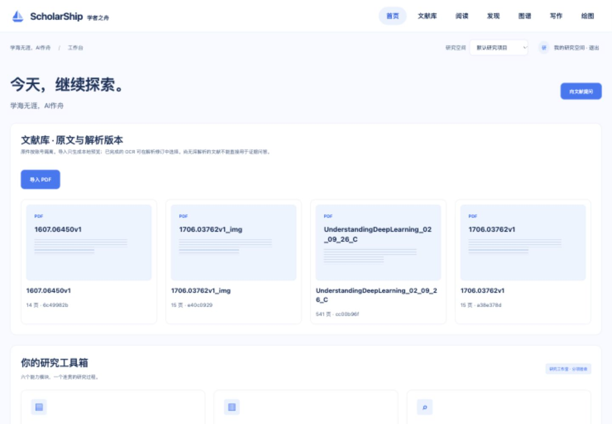
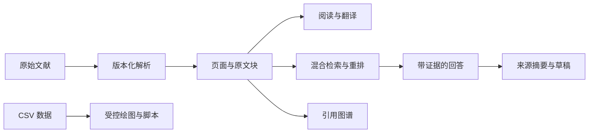

<p align="center">
  
</p>

<p align="center"><strong>从文献到洞察，让研究有据可循。</strong></p>

<p align="center">
  文献管理 · 证据问答 · 双语阅读 · 引用图谱 · 写作与绘图
</p>

<p align="center">
  <a href="#快速开始">快速开始</a> ·
  <a href="#功能">功能</a> ·
  <a href="docs/guides/models.md">模型配置</a> ·
  <a href="docs/guides/deployment.md">部署</a> ·
  <a href="docs/README.md">文档</a> ·
  <a href="https://github.com/JingleiCui/ScholarShip/issues">反馈问题</a>
</p>

ScholarShip 是一个可自托管的 AI 科研工作空间。将论文、教材、阅读笔记、问答证据和写作产物放在同一条研究流程中：导入资料，阅读与提问，查看原文，再把结论整理成草稿或图表。

回答不仅有内容，还应有出处。ScholarShip 将引用绑定到具体的文献版本、解析修订和原文位置；更换模型或重新解析资料后，历史记录仍保留自己的来源。



<sub>实际运行界面。文献来自本地工作空间，仓库不附带论文、账号数据或预生成的研究结果。</sub>

## 功能

### 文献与版本

- 导入 PDF，查看本地逐页预览与结构化原文。
- 通过文件哈希复用相同内容，对疑似重复记录进行人工确认。
- 保留论文的不同载体、版本和解析修订，让旧引用仍能回到旧来源。
- 接入 MinerU 原生解析产物；文本型 PDF 也可使用本地结构解析。

### 证据问答

- 选择文献范围，使用 Qdrant 向量与 BM25 混合检索，再通过重排筛选证据。
- 回答关联原文片段、页码与位置，可直接打开 PDF 核对。
- 对作者顺序和表格数值比较使用确定性工具，保留计算依据。
- 保存会话、模型快照和历史审阅记录；范围变化时不混用旧上下文。

### 阅读与翻译

- 阅读原始 PDF，按标题导航，在正文引用与参考文献之间往返。
- 全文或选段翻译，默认逐块上下对照，也可切换双栏同步阅读。
- 公式、代码等字面量在本地保留；片段缓存减少重复处理。
- 译文与原文位置关联，便于对照检查。

### 发现与连接

- 通过 arXiv / Crossref 搜索公开元数据，将可获取的开放 PDF 导入文献库。
- 使用订阅调度和反馈记录追踪研究兴趣，分别展示代码链接与核验状态。
- 从所选文献构建局域引用图，计算 PageRank，并区分已核验引用与候选关系。
- 为研究方向保存后续检索词、时间、范围与证据，避免把“没有找到”写成“尚未解决”。

### 写作与可复现绘图

- 基于所选文献生成来源摘要与论文框架，保存草稿版本和来源清单。
- 从 CSV 生成表格、折线、柱状、散点、二维雷达或三维雷达图。
- 图像、输入数据、配置和 Python 脚本一起导出，单位、缺失值与归一化规则可检查。
- 将步骤描述或明确的节点、连线转换为 Mermaid 架构图，并导出源码。

### 自己选择模型

- 统一配置生成、翻译、向量、重排与解析能力，按用途选择服务。
- 保留合成测试、本地模型及云端 API 的独立配置组。
- 新任务冻结模型与协议绑定；向量模型切换通过新索引世代验证后生效。
- 模型选择、外部访问权限和用量准入相互独立，不因填写 Key 自动发起请求。

> 项目仍在积极开发。云端服务默认关闭，本地模型服务需另行安装。模型译文和写作草稿需要人工核对；跨论文问答、真实检索推荐与长文档处理的质量覆盖仍在完善。完整边界见[能力与验证范围](docs/guides/capabilities.md)。

## 快速开始

本地开发已验证环境：**macOS Apple Silicon、Python 3.12、Docker Desktop**。

1. 启动 Docker Desktop，确认本机安装了 Python 3.12。
2. 克隆仓库，检查 `bootstrap.py` 顶部的 `BOOTSTRAP_PYTHON` 是否指向本机解释器。
3. 初始化并启动：

```bash
git clone https://github.com/JingleiCui/ScholarShip.git
cd ScholarShip
python3.12 bootstrap.py
.venv/bin/python dev.py
```

打开 **[http://127.0.0.1:15173](http://127.0.0.1:15173)**。API 文档位于 [http://127.0.0.1:18080/docs](http://127.0.0.1:18080/docs)。

首次初始化会自动生成私有 `.env` 和随机账号密码，不需要预先复制空模板。使用 `researcher` 登录，密码见 `.env` 的 `INITIAL_USER_PASSWORD`。导入一份自己的 PDF，即可开始本地文献管理与阅读。

无需模型 Key 即可使用本地文献管理、受控图表与合成契约流程。真实问答、翻译和模型生成需要进一步配置服务与调用策略。

[详细安装](docs/guides/getting-started.md) · [模型配置](docs/guides/models.md) · [Docker Compose](docs/guides/deployment.md) · [运行与故障排查](docs/runbook.md)

## 工作原理



PostgreSQL 保存业务状态、任务与来源关系；Qdrant 提供向量和混合检索；Celery、Redis 与 Beat 负责后台执行和调度。供应商目录、协议转换、HTTP 传输与业务工作流分别组织，通过统一端口连接。

| 层次 | 技术 |
|---|---|
| 前端 | React、TypeScript、Vite |
| 文献展示 | PDF.js、KaTeX、Cytoscape.js、Mermaid |
| API 与工作流 | Python 3.12、FastAPI、LangGraph |
| 数据与检索 | PostgreSQL、SQLAlchemy、Alembic、Qdrant |
| 后台任务 | Celery、Redis、Celery Beat |
| 分析与绘图 | Pandas、NumPy、Matplotlib、NetworkX |

详见[架构设计](docs/architecture.md)、[工作流与产物设计](docs/studio/design.md)、[模型适配设计](docs/models/adapter-design.md)。

## 开发

```bash
# 检查运行依赖
.venv/bin/python doctor.py

# 检查代码、前端构建和后端集成
.venv/bin/python validate.py

# 停止本项目的本地启动器，保留基础容器与数据
.venv/bin/python stop.py
```

验证需要基础容器运行，会创建独立的临时数据库、队列和向量集合。运行报告输出到 `var/reports/`，不进入 Git。

```text
frontend/          页面、阅读器与交互组件
backend/           API、领域逻辑、模型适配、任务与迁移
local_services/    可选的本地模型服务
model_config.py    模型、协议与运行参数
bootstrap.py       项目工具链、配置和基础环境初始化
dev.py             本地应用启动器
deploy/            容器构建与反向代理配置
docs/              安装、配置、架构与开发文档
```

[开发与贡献](CONTRIBUTING.md) · [AI 辅助开发说明](docs/development/ai-assisted-development.md)

## 数据与安全

原始文献、密钥、账号数据和运行产物保存在自己的环境中，不随源码分发。启用外部服务后，相应文本会发送给所选供应商；本地服务与云端服务应按实际数据需求选择。

不要将 `.env`、数据库备份、会话 Cookie 或私有文献提交到仓库。问题报告与安全联系说明见 [SECURITY.md](SECURITY.md)。

## 许可证与第三方组件

项目整体许可证尚未指定。依赖与参考来源见 [THIRD_PARTY_NOTICES.md](THIRD_PARTY_NOTICES.md)，各第三方组件遵循自身许可证。
