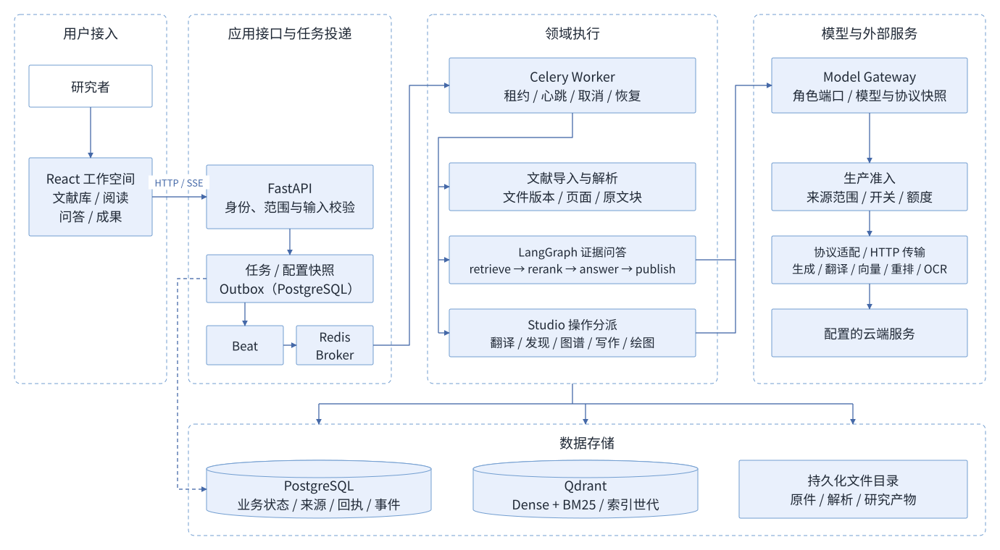

<p align="center">
  
</p>
<p align="center"><strong>学海无涯，AI作舟。</strong></p>
<p align="center">
  
  
  
  
  
  <a href="#license"></a>
</p>
<p align="center"><a href="README.en.md">English</a> | <a href="README.md">简体中文</a></p>

**ScholarShip（学者之舟）是面向学生与个人研究者的 AI 科研工作空间。** 从一篇 PDF 开始，在同一处阅读、翻译、提问和整理成果。回答中的引用可回到原文位置，译文与草稿保留来源和修订记录。

项目将分散的文献、对话和研究笔记连接起来：**文献版本 → 解析修订 → 原文片段 → 研究产物**。你可以沿这条来源链核对材料，再决定如何使用生成内容。

<p align="center"><a href="#demo">演示视频</a> · <a href="#features">核心能力</a> · <a href="#architecture">系统架构</a> · <a href="#quickstart">快速开始</a> · <a href="docs/guides/user-manual.md">使用手册</a></p>

<a id="demo"></a>
## 功能速览

<p align="center"><a href="docs/assets/demo-preview.mp4"></a></p>
<p align="center"><sub>点击观看demo视频</sub></p>

[demo高清视频](docs/assets/demo-preview.mp4) · [详细操作版](docs/assets/demo.mp4) · [从头使用教程](docs/guides/first-research-session.md) 
按使用顺序展示一次：**新建空间 → 导入 PDF → 本地解析 → 索引与提问 → 引用核对 → 双语阅读 → 文献发现与图谱 → 写作 → 绘图与导出 → 成果回看**。全部等待、调试和重复切换已剪除，保留关键操作和完成结果。

视频为真实页面录制，1920×1080、25 fps，带中文步骤字幕。新建问答与写作使用明确标记的模拟模式，真实回答与译文为历史成果回看；未新增云端推理、OCR 或全文上传。Crossref 检索只发送公开查询词。

<a id="features"></a>
## 核心能力

典型场景：导入某个研究方向的文献，选定来源提问，点击引用核对 PDF；对照原文修订译文，再将摘要、研究线索和图表保存为可回看的成果。

| 能力 | 主要操作 | 来源与产物管理 |
|---|---|---|
| 文献管理与解析 | 批量导入 PDF、核对重复候选、管理版本、提取文本结构 | 文件哈希、不可变解析修订、页面与原文块 |
| 检索与证据问答 | 在选定的 1–8 个文献版本中提问，沿引用核对原文 | 向量 + BM25、重排、固定来源范围、证据不足时拒答 |
| 双语阅读 | PDF 阅读、选段或全文翻译、双语对照、人工修订与导出 | 公式与代码字面量保护、片段缓存、译文版本 |
| 文献发现与跟踪 | arXiv / Crossref 元数据检索、订阅、反馈评分与身份核对 | 允许来源下载、候选身份审阅、追踪记录 |
| 引用图谱与研究方向 | 查看局域引用图、整理来源摘要与方向草稿、核查后续证据 | 候选边标记、局域 PageRank、来源清单与人工核查 |
| 写作与可复现绘图 | 整理摘要与论文框架；从 CSV 生成图表，从节点和边生成 Mermaid 图 | 草稿版本；数据、图像、配置与 Python 脚本导出 |

各工具可按需要独立使用。**证据问答需要就绪的解析与索引；翻译、写作和 CSV 绘图不要求先完成问答或建索引。** 本地预览、文本层提取、图谱计算和受控绘图无需模型 Key；公开元数据检索会联网。模型生成另需配置服务和执行准入。

<a id="architecture"></a>
## 系统架构

ScholarShip 采用 **React + FastAPI 模块化单体**。API、Celery Worker 与 Beat 分进程运行，共享领域代码。PostgreSQL 保存权威业务状态，Redis 负责消息投递，Qdrant 保存可重建检索索引，持久化文件目录保存原件与产物。



### 证据问答工作流

LangGraph 按 **检索 → 重排 → 回答 → 发布** 四个节点执行。任务固定来源与模型配置，节点状态通过 PostgreSQL 检查点持久化。作者顺序、表格计算等确定性工具可在节点内复用结果；翻译、图谱和写作等任务通过 Studio 操作分派执行。


关键设计：

- **来源随版本保存。** 引用绑定文献版本、解析修订与原文跨度，重解析保留旧回答的来源。
- **长任务可追查。** Outbox 保存投递意图，Worker 使用租约与心跳，SSE 展示持久化任务事件。检查点与外部调用回执分别记录，结果未知时先对账再恢复。
- **模型统一接入。** `model_config.py` 与 Gateway 管理角色、协议、配置快照和调用准入。更换向量模型先创建新索引世代，真实与模拟 profile 分开保存。
- **隔离落实到数据层。** 租户事务设置 `app.owner_id`，配合 RLS 与归属约束；检索候选回到 PostgreSQL 核对来源后才进入证据。

[架构详解](docs/engineering/architecture-current.md) · [其他架构视图与可编辑源码](docs/engineering/architecture-gallery.md) · [代码导读](docs/engineering/code-walkthrough.md) · [目录与验收入口](docs/engineering/repository-layout.md) · [模型接入设计](docs/models/adapter-design.md)

<a id="quickstart"></a>
## 快速开始

### 1. 准备环境

已验证的开发环境为 **macOS Apple Silicon、Python 3.12 和 Docker Desktop**。先启动 Docker Desktop。初始化脚本准备项目专用的 Python、Node 与 pnpm 工具链；Windows / Linux 自动初始化尚未验证，其他运行方式见[部署说明](docs/guides/deployment.md)。

```bash
git clone https://github.com/JingleiCui/ScholarShip.git
cd ScholarShip
python3.12 --version
docker compose version
```

### 2. 初始化

将 `bootstrap.py` 顶部的 `BOOTSTRAP_PYTHON` 设为本机 Python 3.12 路径（可用 `command -v python3.12` 查看），然后运行：

```bash
python3.12 bootstrap.py
```

初始化会生成 `.env` 和初始账号、准备基础容器并执行数据库迁移。已有配置与数据会保留。**首次运行不要预先复制空的 `.env.example`，已有 `.env` 不要用模板覆盖。** 首次使用保留 `EXTERNAL_SERVICES_ENABLED=false`，无需模型 Key。

### 3. 启动与登录

```bash
.venv/bin/python dev.py
```

打开 **http://127.0.0.1:15173**，以 `researcher` 登录，密码在本地 `.env` 的 `INITIAL_USER_PASSWORD` 中。API 文档：[http://127.0.0.1:18080/docs](http://127.0.0.1:18080/docs)。本地应用与容器应用模式互斥，请勿重复启动 Worker 或 Beat。

### 4. 完成第一次阅读

1. 创建研究空间，在“文献库”导入有权使用的 PDF。新克隆不附带开发者的文献、索引或模型额度。
2. 选择文献并“开始阅读”，先查看原件，再按需要运行“提取文本结构（本地）”。扫描件需要 OCR，本地文本层提取不能替代 OCR。
3. 按任务选择工具：问答先建立索引，双语翻译和写作需要模型配置，CSV 绘图可直接本地运行。
4. 在“成果”回看已保存的回答、译文、摘要和图表，再沿引用或来源标记核对材料。

| 执行方式 | 用途 | 要求 |
|---|---|---|
| 本地工具 | 导入、预览、文本结构提取、图谱计算与受控绘图 | 无模型 Key |
| 模拟模式（mock） | 在独立练习空间体验检索、问答与翻译流程 | 输出带模拟标记，不用于研究结论 |
| 本地模型 | 真实问答、向量化、重排、翻译与视觉 | [本地准备与验收](docs/models/local-setup.md) |
| 云端模型 | MinerU 解析及可选模型 API | [模型配置与生产准入](docs/guides/models.md) |

停止本项目的本地进程，保留基础容器和数据：

```bash
.venv/bin/python stop.py
```

[安装细节](docs/guides/getting-started.md) · [完整操作手册](docs/guides/user-manual.md) · [故障排查](docs/runbook.md)

## 项目结构

```text
ScholarShip/
├── frontend/src/                # 页面导航、PDF 阅读、引用定位与任务交互
├── backend/
│   ├── src/scholarship/
│   │   ├── api/                 # HTTP 接口、会话、请求校验与 SSE
│   │   ├── domains/             # 文献、解析、检索、问答与 Studio 工作流
│   │   ├── models/              # 模型目录、协议、传输、网关与调用准入
│   │   ├── infrastructure/      # 数据库、存储与基础服务
│   │   └── workers/             # 后台执行、投递与调度
│   ├── migrations/             # Alembic 前向迁移
│   └── tests/                  # 契约与集成测试
├── deploy/                     # 容器构建和反向代理
├── docs/                       # 使用、架构、模型与开发说明
├── model_config.py             # 统一模型配置
├── bootstrap.py                # 环境初始化
├── dev.py / stop.py             # 本地应用启停
└── doctor.py / validate.py      # 诊断与工程检查
```

## 文档与参与

[文档首页](docs/README.md) · [开发与贡献](CONTRIBUTING.md) · [安全说明](SECURITY.md) · [AI 辅助开发说明](docs/development/ai-assisted-development.md)

项目由个人开发，欢迎通过 Issue 提供可复现的问题和改进建议。请勿附带密钥、会话 Cookie、个人数据或无权分发的论文。启用外部服务后，相关内容会发送给所选供应商。

<a id="license"></a>
## 📄 License

本项目采用 **GNU Affero General Public License v3.0（AGPL-3.0）**，完整条款见根目录 [LICENSE](LICENSE)。
