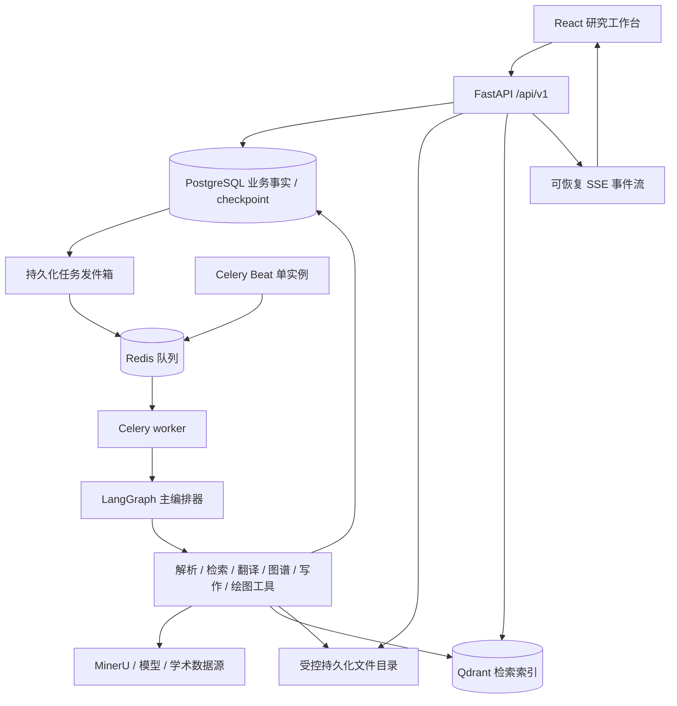
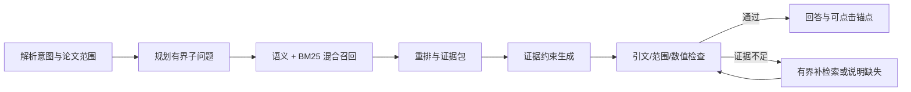

# ScholarShip 架构评审稿

版本：2026-11-13。状态：用户已确认，见[评审结论](architecture-review.md)。以下是待实施设计，不代表已存在服务或 API。

## 1. 总体结构

采用单仓库、模块化后端；前端、API、后台 worker、调度器分别运行。首版同一台服务器部署，避免提前拆分微服务。原始论文、解析产物及生成文件使用可备份持久卷。评审服务不依赖开发者 Mac 在线。

PostgreSQL 保存权威业务状态，Qdrant 是可重建检索索引，Redis 是任务传递通道；后三者之间不假设跨系统原子事务。文件使用暂存、校验、原子发布与回收记录完成一致性管理。

## 2. 模块与职责

| 模块 | 职责 | 禁止承担的职责 |
|---|---|---|
| identity / projects | 登录、个人科研空间、评审账号与归属过滤 | 把模型输出当成权限判定 |
| library / ingestion | 上传、内容去重、版本选择、导入与删除协调 | 仅凭文件名合并论文、自动覆盖原件 |
| documents | 解析适配、结构块、标题、图表公式、参考文献与位置映射 | 把快速文本预览标记成完整深解析 |
| retrieval / evidence | 混合检索、重排、证据范围与事实检查 | 允许模型提供任意其他账号的检索范围 |
| reader / translation | PDF 叠层、锚点、双向引用导航、术语与翻译对齐 | 将旧解析锚点静默映射到新正文 |
| discovery | 标题/引用解析、学术源检索、开放全文下载、追踪与反馈 | 绕过全文访问限制或将接口错误当无结果 |
| insight | 引用子图、中心性、综述、未来方向核验 | 将局域排名称为整个领域的客观地位 |
| writing / visualization | 证据约束写作、受控绘图、脚本和图注 | 虚构结果、任意执行模型或用户提交的 Python |
| agent / runs | 主任务规划、工具选择、预算、状态与恢复 | 重做各领域模块的业务校验 |
| artifacts / audit | 文件版本、来源、执行记录、导出与下载 | 把日志中一句“完成”当成功事实 |

领域服务通过显式接口协作，避免直接操作其他模块的数据库实体。关系表、字段、索引与迁移在下一阶段单独设计。

## 3. 关键数据身份与证据链

本节规定语义身份，不规定数据库表结构：

- **论文身份**：同一学术作品的版本集合；arXiv/DOI 等标识和正文相似度共同辅助匹配。
- **文件/论文版本**：不可变文件及校验和。显示名可变，正文身份不随重命名变化。
- **解析版本**：绑定文件版本、解析器及配置版本，重跑产生独立结果。
- **原文结构块**：绑定解析版本、页码、块顺序、类型与位置；作为问答、翻译、引用和图谱的共同锚点。
- **检索块**：由原文结构块派生，记录来源、嵌入模型及索引版本；不能替代原文。
- **证据引用**：记录明确原文版本、块、引文和支持对象；派生数值另记录计算输入与规则。
- **产物版本**：绑定输入版本、生成代码/模板、模型/工具、参数、时间及校验和。

统一位置采用页内归一化、左上角原点坐标；保留解析器原坐标、页尺寸及旋转转换信息。PDF.js 使用统一转换高亮；表格和公式不能通过字符串搜索猜测位置。解析器无可靠坐标时只显示其实际提供的页级定位并标明精度。

原件 → 解析版本 → 原文块 → 检索/翻译/引用关系 → 证据 → 回答/综述/框架；CSV 输入版本 → 数据检查/变换 → 脚本 → 图表 → 图注。链接始终指向已发布的明确版本。

## 4. 六模块工作流

### 4.1 导入与版本

上传文件先进入受限暂存区，检查文件类型、大小、页数及可读取性。快速提取提供预览与初步元数据；深解析异步进行。扫描件无文本层时展示 OCR 待处理状态，空白页不能单独作为扫描件判断依据。

先用文件/规范化文本校验识别完全重复，再用正文片段相似度、标题作者等证据识别论文版本；arXiv 版本号从可核验元数据获取，文件名只作提示。相同主题不能直接判为同一作品。疑似重复进入用户决策，提供保留现有、设新版本为当前或两版保留；“替换当前”不物理删除历史原件。

MinerU 适配器保留远端 task ID，查询进度、下载并校验结构化结果。长书按页/章节分批处理、持久化进度、限制并发和上下文，允许先读已完成内容；全量完成前保持部分完成状态。所有结果解析完成且索引验证通过后，才切换该文档的活动检索版本。

### 4.2 证据问答与多文推理

服务端强制注入账号、项目、文档版本与索引就绪过滤。中文问题允许有界英文检索改写，保留原问题及检索词。跨论文对比先按论文和比较维度收集证据，再生成矩阵；缺失单元格明确显示未找到。

β 参数、GPU 型号、模型参数量等关键实体保留原文字符和单位。差值、倍数等由确定性计算产生，附原始数值和公式。校验至少包含引文存在、版本一致、位置可达及数值出处；更强语义核验按任务需要启用。检查不等于保证语义正确，仍需验收集与人工核对。

### 4.3 阅读与翻译

前端以 PDF.js 显示原件；结构化翻译通过 Markdown/HTML 展示，首版不生成保持原位排版的译文 PDF。代码、公式及引用标记通过占位与回填保护，翻译逐块缓存，术语表随项目维护。

双向同步依赖“原文块 ↔ 译文块”的身份映射与当前可见锚点，采用滚动来源锁避免互相触发；不按页面总高度比例同步。大书两侧窗口化渲染，目录按需加载。引用跳转保存返回位置栈，处理一个条目多处引用；无法识别的引用保留文本并标注。

### 4.4 检索、追踪与推荐

学术来源适配器统一返回标识、标题、作者、时间、链接、来源接口、检索时间和可获取范围。首版接入 arXiv、OpenAlex、Crossref 与 PubMed；各源能力、配额和权限按实际核验，不以空结果掩盖限流或连接故障。

给定标题/引用先消歧，再获取开放或合法授权全文；只有元数据时允许保存条目，并明确无法全文问答。引用重要性基于引用语境、方法承袭、主题相关性及用户筛选；保留可解释理由，不物理删除弱相关或相反证据。

Beat 单实例触发增量抓取，持久化各源游标、时间窗口和去重状态；按来源限流、退避。推荐综合主题相关性、时间、代码链接和反馈。GitHub 链接是否存在、是否官方、是否验证可运行分别记录，不能把“有链接”称作“已复现”。首版使用内容与显式反馈排序，不训练协同过滤模型。

### 4.5 图谱、综述与未来方向

引用边统一定义为“引用论文 → 被引论文”。边必须来自解析引用标记/参考条目或带来源的外部引用记录；同名歧义保留待确认，不用语义近似生成引用关系。

NetworkX 在用户选定、固定版本的子图上计算入度、PageRank 和中心性，前端显示样本范围、算法及“局域基石候选”。综述从图谱和原文证据联合生成，逐条关联来源。

Future Work 提取绑定论文时间与原文；对候选方向执行截至某时的后续文献检索，区分已有解决证据、部分涉及、未检索到解决证据和覆盖不足。保留支持/反对/局限，不承诺证明全球创新性。

### 4.6 写作与绘图

写作从用户 idea、已核验证据和论文元数据生成结构化草稿。References 从已核验记录格式化产生，不由模型自由编造；事实论断链接原文证据。计划实验、预期结果与已完成结果分别标注。

CSV 上传后检查列名、类型、缺失、单位和大小。模型提出 `PlotSpec`，后端白名单校验，再通过预置 Python 模板执行 Pandas/Matplotlib；数据处理、绘图脚本和图片同时保存，图注只能引用实际计算出的趋势。支持表格、折线、柱状、二维雷达及有明确第三维语义的三维雷达模板；缺少必要列或语义时返回需要补充信息。

首版运行受控模板，模型生成的任意 Python 仅作为待审文本，不直接执行。计算放入独立子进程，限定运行时间、输入规模、输出目录及继承环境，不传模型密钥。Mermaid 使用结构化图定义生成、严格模式渲染，保存源码；输出下载按产物版本鉴权。

采用可重复加载数据和脚本的执行记录，首版不承诺计算进程的变量跨重启存活。此取舍保留科研复现能力，并控制持久内核的实现与运维成本。

## 5. Agent、后台任务与恢复

一个 LangGraph 主编排器调用各领域工具，复杂问题可拆解为受控子流程。各能力处理器不各自启动无限自治循环。普通 CRUD、确定性解析和索引步骤直接调用服务，避免无价值的模型调用。

运行状态：`queued → running → waiting_user / succeeded / partially_succeeded / failed / cancelled`。取消请求先记录 `cancel_requested`，停止确认前不显示已取消。部分成功必须列出已完成与失败子项，不能使用总成功掩盖局部失败。

- **任务投递**：业务记录和 outbox 在同一 PostgreSQL 事务提交；worker 投递器将 outbox 送入 Celery，重复投递由业务幂等键吸收。
- **幂等语义**：不承诺 exactly-once。解析/索引/产物以文档版本、配置版本和操作身份识别重复；重复投递不产生重复业务效果。
- **外部调用**：先保存调用意图及可用远端标识。超时但可能已执行时保留未知状态，优先查远端回执；不能盲目重建计费任务。
- **租约与恢复**：worker 心跳/租约识别失联；重启后按持久化阶段、checkpoint、调用回执与文件校验恢复，不从头重放所有副作用。
- **持久化分工**：LangGraph checkpoint 保存图状态；业务任务保存用户可见状态；调用记录与产物记录提供成功依据，三者通过运行/步骤身份对应。
- **索引一致性**：Qdrant 数据使用文档/解析/嵌入版本身份写入并验证；完成前不切活动版本。删除先撤销可检索资格，再异步清理索引和文件。
- **文件发布**：临时路径写入、校验后原子改名并登记产物；发布失败回收孤儿文件，元数据缺失时不给出成功下载链接。

任务默认最多自动重试 2 次，只有可重试错误使用退避；不重试无效输入和权限错误。模型规划默认最多 8 轮；超过预算、无进展或反复失败时终止并展示已取得的结果。这些初值作为可编辑配置，不视为效果最优参数。

## 6. 前后端接口边界

所有路径属于拟议 `/api/v1`，具体请求/响应模型在接口与数据设计阶段落定。前端通过生成的类型客户端调用，不直接访问 PostgreSQL、Qdrant、Redis、供应商密钥或服务器文件系统。

| 接口组 | 行为约定 |
|---|---|
| `/auth/*`、`/projects/*` | 登录/退出、个人空间与项目；首版手工创建账号，无公开注册 |
| `/uploads`、`/documents/*` | 上传回执、文档/版本列表、重复候选与用户决策、解析摘要、块和参考文献 |
| `/documents/{version_id}/content` | 鉴权原始 PDF 内容，支持 Range；外部下载地址不作为永久原文锚点 |
| `POST /runs`、`GET /runs/{run_id}` | 提交有类型任务、查询状态；长任务返回 HTTP 202 与运行身份 |
| `/runs/{run_id}/events`、`/runs/{run_id}/cancel` | SSE 事件及显式取消请求；重连按事件游标补读 |
| `/graphs/*`、`/recommendations/*`、`/subscriptions/*` | 固定范围图谱结果、推荐与反馈、追踪配置与运行记录 |
| `/artifacts/{artifact_id}/versions/*` | 产物历史、确切版本的元数据/预览/下载 |

`POST /runs` 统一承载解析、索引、问答、翻译、检索下载、图谱分析、综述、方向核验、写作及绘图等任务类型。前端发送结构化输入和请求身份，工具校验与资源范围由服务端执行。

错误采用统一的机器可读错误码、用户可读信息、请求身份及是否可重试；区分输入无效、证据不足、来源限流、额度不足、依赖不可用与内部错误。证据不足属于业务结果，不伪装成系统故障或编造答案。

SSE 持久化事件拥有单调游标，至少包含任务进度、公开步骤摘要、回答增量、已发布产物和最终状态。业务事实先提交再通知；token 增量可批量持久化，不能依靠逐 token 提交支撑长输出。前端断线只恢复订阅，不重复提交任务。历史游标超出保留范围时返回需重新读取快照，不静默漏事件。

前端可展示检索范围、工具名称、处理进度和证据；不展示模型隐藏思维链、原始敏感参数或密钥。尚未核验的流式草稿标明待核验，最终结论带核验状态。

## 7. 首版界面与运行资源

研究工作台包含文献库、阅读/双语/证据工作区、检索推荐、引用图谱与洞察、写作绘图五个入口，并提供全局任务中心。问答常驻阅读侧栏，点击证据定位到实际原文版本；图谱节点可打开同一阅读器。

部署入口提供同源静态资源与 API 反向代理，SSE 禁用代理缓冲并配置连接超时；前端构建后无须常驻 Node 服务。数据库、向量库与 Redis 仅内部网络可达。明确健康检查、数据卷、重启策略与备份恢复流程，机器规格在真实数据测试后确认。

首版采用个人空间和独立评审账号，账号间隔离；登录使用服务端会话、HttpOnly Cookie，同源写操作校验 Origin/CSRF。评审账号的上传和调用配额独立配置，不依赖前端隐藏按钮限制访问。

## 8. 费用、可观测性与验收

费用记录区分模型、向量、重排、解析和搜索。每次调用记录模型/价格版本、输入输出用量、估算/实际状态、运行身份和重试原因。调用前预留最坏情况下的预算；并发任务共享原子预算准入，未知扣费不立刻释放预留。供应商账单仍是最终扣费依据。

项目模型预算以用户期望的 100 元内为目标，具体硬限额与周期在配置评审确认。全文翻译按需、分块缓存；原生 PDF 不逐页默认调用视觉模型；解析、嵌入与生成按内容/模型/参数版本缓存，避免错误复用。

结构化日志关联请求、运行、步骤、文档与产物版本；敏感参数脱敏。记录任务耗时/排队、失败、外部限流、检索证据命中、首字延迟、调用成本与服务内存峰值；为关键供应商故障提供可读状态。

验收用真实官方文件与人工核验答案。单元与离线集成测试不能代替 OCR、真实模型、真实下载及公网演示测试。具体用例见[验收矩阵](acceptance.md)。

## 9. 下一阶段与评审门槛

用户已确认模块化后端、统一证据锚点、单主编排器、持久化任务、受控计算、个人空间与评审账号等架构决策。当前数据设计阶段明确实体关系、版本/块身份、PostgreSQL 表与约束、Qdrant collection/payload/索引、迁移、清理和备份；再确认环境与脚手架。拟议目录为 `frontend/`、`backend/`、`docs/`、`deploy/`，当前只创建文档。
