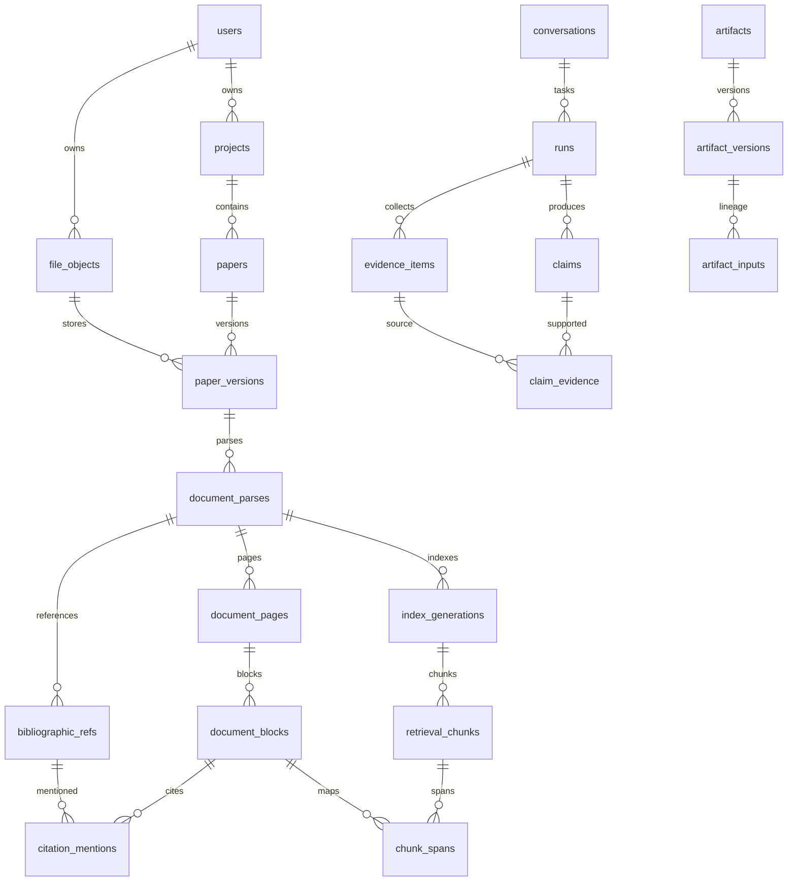

# PostgreSQL 数据设计评审稿

日期：2026-11-13。状态：**用户已确认**，见评审结论。当前只交付设计文件，没有建库、迁移、导入账号或复制原始论文。

配套文件：[数据字典](data-dictionary.md)、[机器可核对目录](data/postgresql-catalog.json)、[Qdrant 设计](vector-design.md)、评审单。数据字典列出字段、类型、可空性、唯一键、外键、CHECK 与索引；实际 SQL/Alembic 在下一阶段实现并在 PostgreSQL 上验证。

## 1. 存储职责与核心关系

| 存储 | 保存内容 | 权威性 |
|---|---|---|
| PostgreSQL `scholar` schema | 账号、文献版本、解析文本、结构位置、检索块、证据、运行、产物元数据、来源及费用 | 业务事实与权限依据 |
| PostgreSQL 独立 `agent` schema | 官方 LangGraph checkpointer 管理的表 | 图状态；不能代替业务成功事实 |
| Qdrant | 稠密向量、词法索引和最小检索 payload | 派生索引，可按 PostgreSQL 与文件备份重建 |
| 持久化文件目录 | 原件、解析包、图表图片、生成脚本、图谱/综述文件、来源响应和可选嵌入缓存 | 内容以 SHA-256 校验，发布后不可变 |
| Redis | Celery 消息与短期协调 | 不保存唯一一份任务、预算、会话或科研证据 |

图中省略运行队列、费用及推荐等辅助关系。语义关系与实际复合外键以数据字典为准；所有关联还需通过账号/项目作用域校验。

## 2. 表分组与规模控制

初稿共 41 张业务表，按职责分组，不额外拆作者、机构、每个模型参数或每类图形的独立表：

| 分组 | 主要表 | 对应能力 |
|---|---|---|
| 账号 | `users`、`auth_sessions`、`projects` | 个人空间、独立评审账号、会话 |
| 文件与文献 | `file_objects`、`uploads`、`papers`、`paper_identifiers`、`paper_versions`、`duplicate_reviews` | 内容去重、论文消歧、版本选择 |
| 文档与引用 | `document_parses`、`document_pages`、`document_blocks`、`bibliographic_refs`、`citation_mentions` | 原文锚点、标题树、引用跳转、图谱边来源 |
| 检索与翻译 | `index_profiles`、`index_generations`、`retrieval_chunks`、`chunk_spans`、`translation_revisions`、`translation_segments` | 混合检索、重建、按块翻译 |
| 会话与运行 | `conversations`、`messages`、`runs`、`run_steps`、`external_calls`、`run_events`、`task_outbox` | 多轮、幂等投递、回执、恢复与 SSE |
| 证据与产物 | `evidence_items`、`claims`、`claim_evidence`、`artifacts`、`artifact_versions`、`artifact_inputs` | 论断溯源、计算依据、可复现绘图、写作和图谱产物 |
| 发现与推荐 | `source_records`、`subscriptions`、`recommendations`、`recommendation_feedback` | 检索来源、定时追踪、解释与反馈 |
| 成本与审计 | `budget_accounts`、`budget_reservations`、`usage_ledger`、`audit_events` | 原子预算准入、未知费用、操作审计 |

图谱快照、综述、未来方向报告和 PlotSpec 通过有类型的产物版本保存，不重复建立另一套内容数据库。引用关系来自参考条目、出现位置和来源记录；图谱文件固化选中文献版本、边证据、算法配置和计算结果。

## 3. 通用约束与数据字典约定

- 主键使用 PostgreSQL `uuid`，应用/数据库生成不透明 ID；向量 point ID 使用确定性 UUIDv5。UUID 不提供访问授权。
- 时间统一 `timestamptz` 并以 UTC 保存；前端按 Asia/Shanghai 展示，论文只有日期时使用 `date`，不虚构具体时刻。
- 金额使用 `numeric(18,6)`，首版预算币种为 CNY；不使用浮点金额。未知费用显式保留，不能用 0 代替。
- 文本字段保持 Unicode；字符串偏移为从 0 开始、Unicode 码点、左闭右开区间，不能混用 UTF-8 字节或浏览器 UTF-16 索引。
- 摘要为小写 SHA-256 十六进制字符串。模型、Prompt、分块器、解析器与配置均有版本/摘要；同维向量但模型不同也不可混用。
- 外键默认 `RESTRICT`；删除通过业务流程处理，不用数据库级联删除科研历史。循环指针先建父/子记录，再在事务中设置。
- 查询及关系列采用普通类型和复合外键；JSONB 保存有 schema 版本的变动结构，不把权限、主关联、金额或活动版本指针藏入任意 JSON。
- 首版使用 B-tree 和必要部分索引；不默认给所有 JSONB 列建立 GIN，不分区、不引入图数据库或 PostgreSQL 向量扩展。
- `updated_at` 在受控更新中统一维护。`append_only` 表及已发布解析内容由权限/更新保护实现不可变；清理角色通过专用维护流程处理，不向常规业务角色开放任意删除。

## 4. 账号与项目隔离

项目表均含 `owner_id`、`project_id`；关联使用复合外键，拒绝跨账号、跨项目绑定。同账号同一内容文件可以复用存储对象，但不同项目的论文、证据与文献匹配彼此独立，不暴露跨账号去重结果。

普通请求先验证服务端会话，再在每个数据库事务设置 `SET LOCAL app.owner_id`；账号来自会话，不采信客户端或模型参数。项目归属校验、仓储查询条件与 PostgreSQL RLS 同时执行。连接池释放事务后上下文必须清空，worker 同样设置可信归属上下文。

所有账号/项目作用域表启用并强制 RLS，条件为 `owner_id = NULLIF(current_setting('app.owner_id', true), '')::uuid`，写入使用相同 `WITH CHECK`。没有上下文则不匹配；错误 UUID 拒绝请求。应用角色不是表所有者，不具备 superuser/BYPASSRLS、TRUNCATE 或修改 schema 的权限。RLS 不替代项目归属和软删除过滤。

`users`/`auth_sessions` 为受保护认证数据，登录与令牌校验使用独立、受限认证访问层；普通业务角色不能读取所有口令或令牌摘要。数据库仅存自适应口令哈希、随机会话令牌哈希及 CSRF 摘要，原始凭据不落库。认证失败的匿名日志不伪造用户归属。

dispatcher/scheduler 通过受限认领操作取得到期任务的 ID 和 owner/project，随后切换普通作用域执行；它们不能通过通用 SQL API读取全部论文。维护角色的跨账号处理单独审计。具体角色/GRANT/RLS 函数在迁移阶段测试。

官方 LangGraph 表独立位于 `agent` schema，交由对应库管理迁移，不复制或修改其内部表结构。每次访问 checkpoint 前，应用先核验 conversation 和 run 的归属，再使用数据库中生成的 `checkpoint_thread_id`；不得直接接受外部 thread ID 查询。一个 conversation 同时最多一个写运行，用锁版本/租约串行化。

## 5. 论文、版本与结构锚点

`papers` 是作品身份，`paper_versions` 是不可变文件载体版本。标题、作者顺序、机构、原文提供的联系方式、摘要及 CSL 风格元数据冻结在版本 `metadata_json` 中（带 `schema_version` 和来源）。用户的显示修正保存在作品 `display_metadata` 并追加审计，不修改版本原始提取记录。生成新引文/产物时将实际采用的元数据、修正及来源一起冻结；旧产物保持原快照。

DOI 规范化为去除解析器前缀的标准小写值；arXiv 作品标识去除 `vN`，版本信息留在版本记录。标识只在消歧确认后进入 `paper_identifiers`，项目内唯一；发现冲突进入用户处理，不静默覆盖。正文相似度、匹配段落、版本证据和候选版本 ID 保存在 `duplicate_reviews` 的版本化结构中，候选 ID 必须逐项校验归属，用户最终选择另有明确外键。

文件/文本相同不等于能够确认新版。只有可核验版本日期或版本标识才给“较新”建议，否则给“无法确定先后”。替换当前版本仅更新指针，保留原件和历史锚点。并发上传通过内容唯一键、幂等回执和文献行锁收敛，不以先查后写代替约束。

解析每次生成独立 `document_parses` 修订；配置相同的就绪结果可显式复用，但用户请求重新解析则新增修订。页记录支持541页教材逐页进度。块 ID 由解析修订、页与块顺序派生，不能跨修订复用。标题树通过同一 parse 的 `parent_block_id` 形成，服务校验无环与阅读顺序。

`bbox` 格式为 `{"x0":0.1,"y0":0.2,"x1":0.8,"y1":0.3}`；数值有限且满足 `0 ≤ x0 < x1 ≤ 1`、`0 ≤ y0 < y1 ≤ 1`。没有可靠坐标时只使用页定位，`bbox=NULL`；原解析器坐标、旋转和变换记录在 `source_locator`。服务校验 JSON 类型、页边界及坐标，不通过文本查找补造框。

表格 `structured_json` 包含单元格/表头/单位，公式保存 LaTeX 与源图，图包含图注和资源文件；这些字段有类型 schema。正文 `raw_text` 与用于检索/引文匹配的 `canonical_text` 均保存，规范化规则版本固定。扫描件的引文是 OCR 识别文本，需展示其精度限制。

参考条目与出现位置分表。`citation_mentions` 同时约束正文块与条目属于同一 parse；合并引用 `[1,2]` 拆成两个可验证映射，References 多页条目的完整块列表在条目结构中保存并校验归属，单个 `entry_block_id` 作为导航入口。未知格式保持原文和未解析状态。

## 6. 索引与翻译版本

`index_profiles` 固化模型、维度、距离、词法/分块版本与摘要；普通业务只能读取，不能悄悄修改配置。项目活动 profile 使用明确外键。`index_generations` 绑定文件版本、解析修订和 profile；块、原文映射、预期 point 清单都保留在 PostgreSQL/文件中。

`paper_versions.active_parse_id` 与 `active_index_id` 要么都空，要么在同一事务切换到相匹配、已验证就绪的组合；复合外键防止索引指向另一个文档或解析。预览/部分深解析可供显式阅读，但不自动进入默认“已完成文献”问答。要对部分内容问答时需明确选择部分范围并标注缺页。

翻译修订绑定 parse、目标语言、模型、Prompt 和术语表摘要，逐块保存。缺失/失败段显示状态，禁止把旧解析译文无声套到新解析。原文块可拆为多个翻译段，按 segment_no 排序；占位符回填一致性校验通过后才 ready。

模型升级在新 profile/新 collection 构建；所有要激活的文档完成后，事务中统一切换项目 profile 与文档指针。失败保留旧 profile，不对不同模型/维度做分数融合。

## 7. 证据、论断与科研产物

证据条目引用明确原文块或不可变外部来源记录。原文引文必须等于 canonical_text 的指定半开区间；位置从块派生，模型不能自行填写其他文档 ID。数据库检查基本范围与同源关系，服务检查字符上界、实际子串、JSON schema、块树与血缘无环；这些跨行/语义规则必须有负例测试。外部元数据证据标明 metadata/abstract/full_text，DOI 可解析不等于正文支持论断。

`claims` 将论断绑定消息或产物版本，两者必须且只能选一个；`claim_evidence` 保存 supports/contrasts/context/operand。派生数字保存确定性计算 schema、原始操作数证据与结果；计划/假设单独标识。claim 与 evidence 属于同一 run，复制历史证据到新运行时重新登记精确版本引用。

`artifact_versions` 不可变，含文件、执行 run/step、配置与类型化元数据。原始 CSV、输入稿件、脚本、图表、图注、图谱和方向报告均可作为产物版本；`artifact_inputs` 的四类输入通过真实外键约束并以 CHECK 强制恰好一种，服务拒绝血缘环。

图表元数据固化列映射、单位、缺失处理、归一化、模板、随机种子（如适用）、计算摘要与环境摘要。雷达图第三维含义缺失时不给出有效绘图产物。图谱元数据固化节点文献版本、引用边证据、算法、范围及排名；JSON 内引用的 ID 同样要验证同项目。历史文件替换用新版本，旧链接仍指向原字节。

## 8. 运行、投递、外部调用与 SSE 事务

1. 创建任务时，在同一事务插入 `runs` 和 `task_outbox`。同作用域幂等键命中时请求摘要相同则返回原运行，不同则返回冲突。
2. dispatcher 认领有期限的 outbox 租约并投递 Celery，成功通知后标记 dispatched。确认前宕机可能重复投递；worker 用状态、租约 token 与业务键吸收重复。
3. `run_steps` 以运行、步骤键、尝试号区分，最多初次加两次自动重试；每次完成须校验当前租约 token。失去租约的旧 worker 不可再发布结果。
4. 外部请求先记录意图和预算预留，再发送；尽早保存远端 task ID。超时可能已执行则记 unknown，先核对远端回执；没有幂等/查询能力时交由明确的人工/重试决定，不从头自动再计费。
5. 输出校验、证据/产物记录、任务状态及事件写入同一业务事务；文件/向量的前后步骤由状态机协调，不声称跨系统原子。
6. SSE 的 seq 通过锁定 run 行递增，插入事件与递增同事务提交。先提交后通知；前端按 `(run_id,seq)` 去重，重连读取 `seq > last_seen`。
7. 批量落库 token 草稿，终态消息固定；更正追加消息。历史事件清理后更新 `event_floor`，请求旧游标返回重读快照指引。取消先记 cancel_requested，停止确认后才能 cancelled。

run 状态与 library checkpoint 分开；run 的 input_scope_json 固化当次文献/解析/索引/profile 范围和配置，不能在恢复时悄悄改用新“当前版本”。

追踪任务的 schedule_json 保存周期规则，timezone 使用有效 IANA 名称（默认 Asia/Shanghai），next_due_at 转 UTC。各来源成功保存记录后才推进对应游标，单源失败不推进其时间水位。推荐 canonical_work_key 采用规范化作品标识，同作品新版本更新同一推荐并标明版本变化；修改前的来源和分数进入审计，显式反馈不因源记录更新而丢失。

## 9. 成本与预算事务

budget account 按账号、周期和类别设置。先 `SELECT ... FOR UPDATE` 锁定账户，校验 `spent + reserved + 本次预估上限 ≤ limit` 后插入 reservation、调用意图并增加 reserved。所有配置写入需持有账号/类别的事务 advisory lock，检查同类别的半开周期区间不重叠；该跨行规则经受控配置服务执行，必须测试并发配置，不能误称单列 CHECK 已经保证。

回执结算在一个事务内按调用幂等键追加 usage ledger、减少相应 reserved、增加 spent，并使 reservation settled。确定未发出或无扣费才 released；未知调用保持 unknown 和预留。供应商费用修正追加有唯一 entry_key 的调整项，不改旧账本。reservation、call、account 的组合须通过复合外键保持一致。

usage_estimate 表示按供应商用量和价格快照计算的费用，billing_reconciliation 才表示供应商账单核对。超预估的真实账单仍必须完整入账并阻止后续准入，不能截断账目以显示未超预算。100 元预算目标不等于供应商硬停机保证，具体限额/周期在配置阶段确认。原文响应若含密钥先脱敏再入库/文件。

## 10. 生命周期、删除和备份

- 普通删除：事务中软删除文献/版本，撤销活动资格、取消相关任务并写清理 outbox；所有读取（包含证据和文件下载）检查 tombstone。Qdrant 即使尚未删完也不能继续泄露内容。
- 历史版本：只切当前版本不删除；历史证据保留确切来源。明确删除来源后，历史回答显示“来源已删除/不可用”，不改指向另一个版本。
- 孤儿与过期索引：等待在途运行释放范围 pin/租约后清理；旧版本向量可以回收，原文与证据历史独立保存。失败构建清理只针对目标 generation，不能删除其他版本。
- 文件复用：按账号内实际引用判断清理资格，引用的文件不得物理删除。常规孤儿至少隔离 24 小时后处理；清理有重试、状态及审计。明确永久删除是单独操作，需用户确认，不能用上传覆盖触发。
- 原始原件、发布产物和长期费用/证据记录默认不自动过期；运维日志/事件的保留期在配置阶段确定。数据库物理删除必须拓扑清理并保留必要审计状态，不执行随意 CASCADE。
- 备份：定期 `pg_dump` 覆盖 scholar/agent schema 与迁移版本；对不可变文件生成校验 manifest。首版备份时短暂停止新发布和清理、等待在途发布协调完成，再建立一致性备份集，避免分别复制得到矛盾快照。
- 恢复：先恢复 PostgreSQL/文件并验证引用和摘要，设置清理/任务恢复隔离；Qdrant 可用配套快照或按 manifest 重建，验证后再开放检索；未知外部调用先查回执，禁止自动重提。恢复演练才算备份验收。

## 11. 迁移和验证安排

建议 Alembic 迁移依次建立：账号/文件/文献 → 解析/引用 → profile/索引/翻译 → 会话/运行/outbox → 证据/产物 → 推荐/成本/审计 → 循环复合外键、RLS、权限和索引。业务迁移与官方 checkpointer 迁移分开记录。迁移不默认破坏数据；升级前备份，不可逆升级明确标记。

初始化阶段必须执行：空库完整升级、外键与唯一键负例、事务回滚、RLS/连接池串租户、并发幂等与预算、不同版本锚点、重复投递、租约抢占、断线 SSE、软删除后检索/下载拒绝、文件/Qdrant 故障补偿、实际备份恢复。结构检查不能代替这些集成测试。

当前验证仅检查设计目录的列存在性、引用目标唯一键、类型匹配和作用域完整性。数据库没有启动，SQL 语法、RLS 实效、查询计划、迁移与并发性能均尚未实测。

## 12. 官方依据

- [PostgreSQL 复合约束](https://www.postgresql.org/docs/current/ddl-constraints.html)
- [PostgreSQL RLS 与所有者/BYPASSRLS 边界](https://www.postgresql.org/docs/current/ddl-rowsecurity.html)
- [LangGraph checkpointers](https://docs.langchain.com/oss/python/langgraph/checkpointers)
- [Qdrant 混合检索](https://qdrant.tech/documentation/search/hybrid-queries/)
