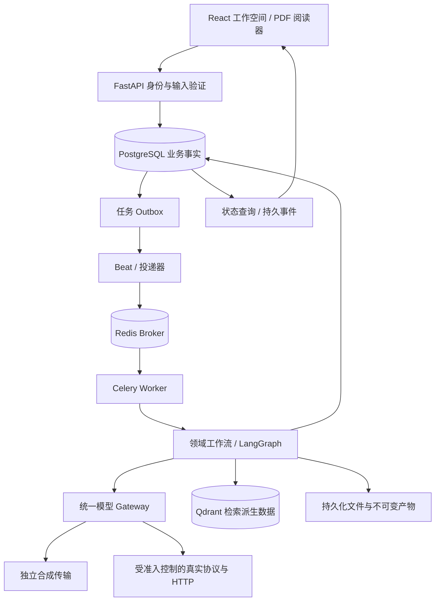
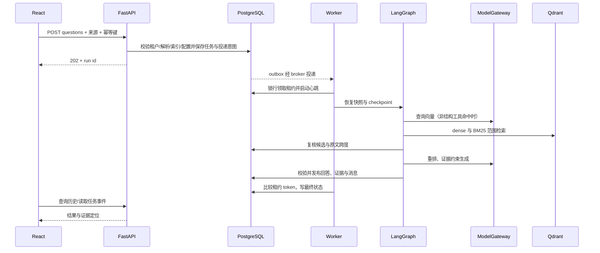
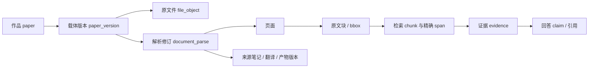
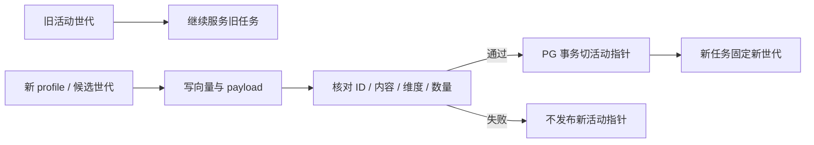

# 当前实现：从文件到可追溯研究产物

基线：2026-11-17 工作区；包含尚未提交的功能补齐改动。本文描述已经写入代码的行为；更改本文不意味着重新执行模型或效果验收。

## 1. 系统定位与职责

ScholarShip 是模块化单体应用：一个 React 前端，一个 FastAPI 后端，后台 worker 与 Beat 作为独立进程运行，共用领域代码和业务数据库。它不是已经拆分部署的微服务系统。选择模块化单体的原因是当前团队与数据规模小，跨版本、证据和任务需要较强一致性，过早拆服务会放大协调成本。

PostgreSQL 是事实源，Qdrant 是可重建的检索副本，Redis 负责消息投递；文件目录存大对象。Redis 中没有消息不代表业务任务不存在，Qdrant 返回的 payload 也不能替代 PostgreSQL 权限和内容核验。

## 2. 一次问答的完整时序

入口为 `api/research.py::ask`，领域入口为 `domains/research.py::enqueue_research`。它检查 1–8 个版本、项目归属、ready 结构解析与执行方式；真实调用还检查供应商／角色策略。随后固定 `config_json`、`input_scope_json` 与解析／索引范围。

`enqueue(..., dispatch=False)` 先登记基础任务，再在后续事务中加配置与 outbox；后一个事务确保配置就绪与可投递意图共同提交。不能笼统说所有入口从头到尾只有一个数据库事务：中间崩溃可能留下尚未投递的基础记录，同幂等键重试可继续配置阶段。探针等入口则在同一事务直接建任务和 outbox。

`workers/tasks.py::dispatch` 领取 outbox，经 Celery 投递。`workers/offline.py::execute_offline` 虽保留历史名称，当前同时执行真实 research 和 studio 任务；名称中的 offline 不保证内部不联网，真正边界是固定的 mode 与 gateway。

问答图在 `domains/offline_workflow.py::qa_graph`：`retrieve → rerank → answer → publish`，使用 `PostgresSaver` 与同步 durability。它是明确的有状态工作流，**不是运行时自主规划工具集合的 ReAct Agent，也不是多 Agent 辩论**。Studio 的翻译／写作等则按 operation 由普通 Python 调度，不能说六模块全部由独立 Agent 自主协商。

## 3. 文件、版本、解析与原文定位

作品代表论文身份；版本代表 v1/v7、标准 PDF／扫描载体等明确来源；解析修订代表同一文件经不同解析器／策略得到的结果。文件 SHA-256 支持完整性与相同字节复用，不是语义去重算法。标题／标识仅产生候选，用户显式关联或保留两份。

预览由 `workers/documents.py` 逐页处理；结构文本由 `domains/studio/local_parse.py` 使用 pdfplumber 等工具提取；MinerU 原生结果由 `domains/mineru_native.py` 校验来源并映射页面／块。坐标映射要处理原 PDF 的裁剪、旋转和页面尺寸，前端 PDF.js 按相应 viewport 展示。

引用链保存固定版本、解析修订、块、字符偏移和 PDF bbox。新解析不改写旧引用；新活动索引就绪前仍使用旧活动修订。公式／表格的大块可以保留在源文而不进入普通向量切片，缺少向量点不应补成伪造内容。

## 4. 数据库和向量库设计

41 张业务表按身份空间、文献文件、解析结构、检索证据、任务会话、发现图谱、产物七类理解，不要死记表名。字段和约束看[数据字典](../data-dictionary.md)。`billing`、`model_runtime` 与 LangGraph checkpoint 等 schema 的支持表不包含在“41 张业务表”口径里。

核心不变量：租户归属一致；引用指向明确版本；已发布结果不被普通角色任意修改；候选索引不能被当作 ready；产物版本能找到输入来源。SQLAlchemy 使用 Core 表对象与事务，不是所有地方都采用 ORM Session／Repository 类。Alembic 用前向迁移；已部署初始目录与 0011–0013 等迁移冻结，不通过修改旧文件改变现网状态。

Qdrant collection 名称含项目与 profile 指纹。payload 同时带 owner、project、version、parse、generation、profile 等字段。查询必须带范围过滤，返回后再与 PostgreSQL 的 chunk 内容哈希及 span 核对，避免串项目、串修订或索引陈旧数据进入证据。

向量 profile 不只保存维度：还有供应商、请求模型、协议绑定、输入策略、模拟标志等。历史离线哈希 profile 为 1,024 维；当前已验扫描件真实回执为 4,096 维，两者不能混用。真实维度从有效回执确认，不能强行截断成早期设计的 1,024 维。

这不是 PostgreSQL 和 Qdrant 的分布式事务。先写派生数据、完整核验，再在 PG 发布指针，利用“不发布半成品”隔离失败。旧任务持有自己的快照；恢复旧任务时还要比较 generation_no，不能把活动指针倒退。

## 5. RAG 与确定性工具

`retrieval_profile.py::chunks` 采用 Unicode 字符边界上的 UTF-8 字节预算，保留原文 slice；字段名虽有 token，当前默认 600/900/80 的含义由 `utf8-bytes-v1` 决定，**不能写成模型 tokenizer 的 600 token**。超长表格、公式、代码有明确保留／跳过策略，不自动把原文压缩成伪引文。

`indexing.py::hybrid` 对每个来源分别召回 dense 40 与 BM25 40，应用侧以 `1/(60+rank+1)` 做 RRF 累加。随后按来源轮转选最多 20 个重排候选，减少单篇挤占；rerank 最多保留 8 条证据。RRF 合并名次而非直接相加不同比例的分数；它不是学习到的最优融合权重。

回答用证据 ID／quote menu 约束，适配器检查未知 ID、引用偏移、Unicode／LaTeX 等；发布前再次验证来源范围。没有证据时直接拒答。存在引文只证明“可以找到那段文字”，不能证明模型的推理和比较基准正确。

`structured_retrieval.py` 与 `table_calculation.py` 对适合结构工具的问题提取作者顺序、表格目标列与比较基准，用 Decimal 计算差值；命中时绕过相应生成环节并保留工具来源。原生表词法补充也会标明它不是 embedding 点。固定案例覆盖需要与泛化准确率分开评价。

## 6. 模型可插拔边界与费用控制

`model_config.py` 是用户编辑入口；`models/catalog.py` 描述能力与供应商，`protocols.py` 负责 wire 格式，`transports.py` 负责 HTTP／代理／超时，`adapters.py` 负责业务操作与标准响应校验，`gateway.py`／`production.py` 负责执行边界与准入。业务模块使用 role 和 operation，不直接拼供应商 URL。

新增兼容供应商优先补目录和配置；协议确实不同才新增插件和契约测试。OpenAI 风格 chat、embedding、rerank 是不同 operation，不能因为接口都接收 JSON 就互相替代。所谓免费模型也是有权限、限流与用量的外部服务。

新任务冻结 models-v2 协议绑定；旧 models-v1 继续按历史规则恢复。切换聊天影响后续任务；切换 embedding 需要新 profile／世代和匹配检查。网络默认不会在未知结果后静默换供应商或转付费型号。

执行前记录调用意图、请求身份与预算预留；成功回执可按严格匹配复用。供应商可能已经执行而本地超时时，进入 unknown／waiting_user，不自动重发或退掉占额。生产准入与测试批次授权分开；配置齐全、账户免费、准入有效也不等于供应商账单已经独立核实。

## 7. 可靠性、隔离与可观测性

Outbox 将可恢复投递意图持久化。投递成功但未写回确认会重复发送，因此语义是至少一次投递配合幂等处理，不是 exactly-once。worker 锁 run 行领取 lease token，心跳续租；写最终结果前比较 token，旧 worker 不能覆盖新执行者。最多三次执行尝试不等于允许对未知外部请求重试三次。

LangGraph checkpoint 保存节点状态，任务表保存业务状态，供应商调用账本保存外部副作用状态。三个层次各管一件事：有 checkpoint 并不能证明远端没有执行过。翻译片段和来源笔记缓存进一步避免已确认的重复工作。

业务事务使用 `tenant_transaction`：在 `engine().begin()` 内用 `set_config('app.owner_id', owner, true)` 设置事务局部租户。提交／回滚后不会将租户上下文留给连接池下一个用户。RLS、复合归属约束和 API 项目检查共同防越权；auth、runtime、checkpoint、migration 角色分工，不给 worker 管理员凭据。

登录使用 Argon2 密码哈希、随机 Cookie 会话、服务端保存令牌摘要；写请求检查允许 Origin 与 CSRF。页面隐藏按钮不能替代后端权限。当前本地 HTTP 的 Cookie 配置不等于可直接安全公网发布，HTTPS 与部署策略需另行完成。

任务事件在 PG 中有递增游标，SSE 支持游标读取；Studio 每 4 秒同步任务列表；展开“实时任务步骤”后读取持久化 SSE 事件。不要把基础 SSE 写成所有模块已经逐 token 流式输出。请求有 X-Request-ID，错误输出保留脱敏类别，避免完整 DSN、Key 或带签名 URL 进入日志。

## 8. 翻译、写作、图谱与绘图

翻译将公式／代码字面量留本地，只发送可翻译文本部分，短 ID 对应原块；合格片段可持久化，失败部分保留失败状态。该设计保护形式，不理解语义否定，必须人工评估。

写作按来源窗口生成并缓存笔记，再组合摘要／框架，产物版本保留来源清单。`editorial_review.py` 做本地编辑派生，不改写原模型回执。论文存在、身份匹配、原文支持三个层次必须分别验证。

图谱使用显式 DOI/arXiv 标识或已验证解析关系建有向边；NetworkX 建图，NumPy 迭代 PageRank，阻尼 0.85、最多 300 次、L1 阈值 1e-12；候选身份在界面单独标注。不是简单说“调用 nx.pagerank 即可”，也不能用局域排名代表领域地位。

发现模块使用 arXiv／Crossref 元数据、受约束的公开下载和明确 GitHub 链接核验，反馈参与词项打分；Beat 调度订阅。它不是训练好的协同过滤推荐系统，长期质量未验收。

绘图对 CSV、字段、有限数值、单位、缺失值和图形类型做校验，执行固定 Matplotlib 模板。导出包冻结实际配置、输入 CSV、图片、元数据和 `plot.py`。它通过缩小可执行范围避免任意代码风险，不是已搭建的容器代码沙箱。Mermaid 同样生成受限节点边并严格渲染。

## 9. 验证证据与改进方向

本批完整回归记录为 225 后端与 3 前端测试；基础恢复、受控图表与固定真实论文样例分别有证据，互不替代。没有并发压测、一般科研问答准确率或长期推荐效果，就不报 QPS／准确率／成本降幅。

优先改进：补官方跨文／多轮独立效果集、专业译文审读、新用户真实模型准入、公开元数据用户旅程，以及模型 token 流、备份恢复与公网评审体验。空间管理、翻译修订和安全取消已在本批实现，见下节。

## 9. 本批补齐的交互与约束

多篇建索引按文献分任务，各任务固定 32 段批大小并在创建前估算次数，所有任务仍受项目用量约束。旧任务读取自己的批大小或历史默认 10；不能为了恢复而修改快照。

人工参考身份核对采用追加式审阅覆盖层，避免修改已发布 parse 内容。图谱读取最新审阅，历史审阅保留。翻译则创建新的 translation_revision，段落保存 parent 来源、原因和模拟状态。

取消是协作式：queued 可直接终止，running 在页、调用批次或发布边界检查；未知供应商结果保持 waiting_user。SSE 展示真实任务事件，不把最终答案分字回放称为流式生成。完整三张图见[架构图解](diagrams.md)。
