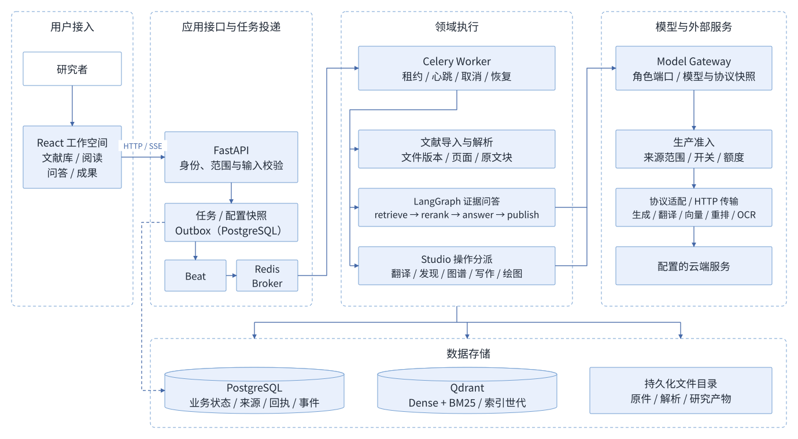
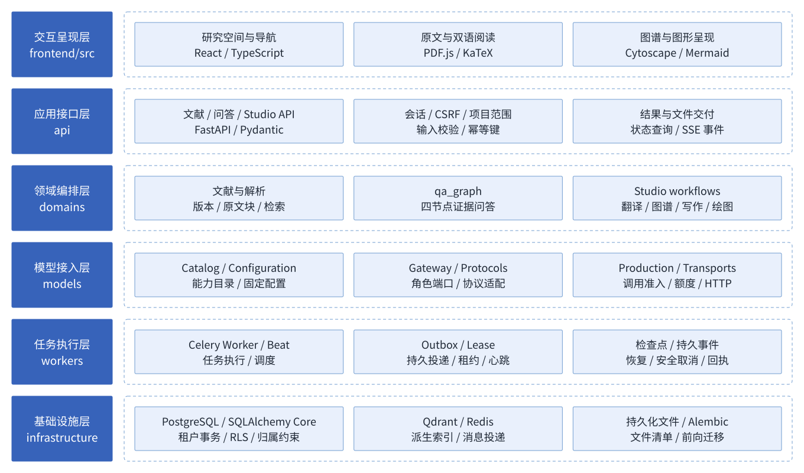
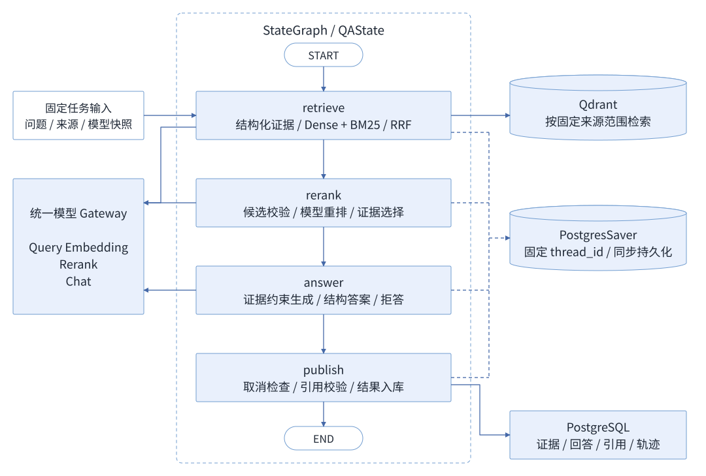
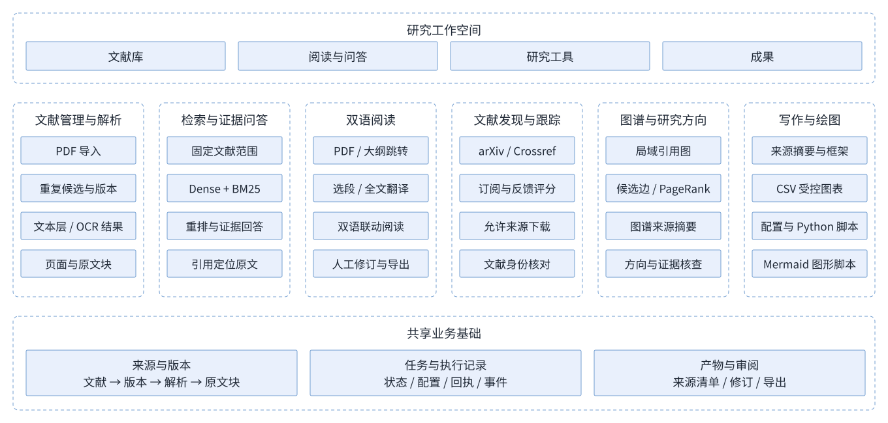
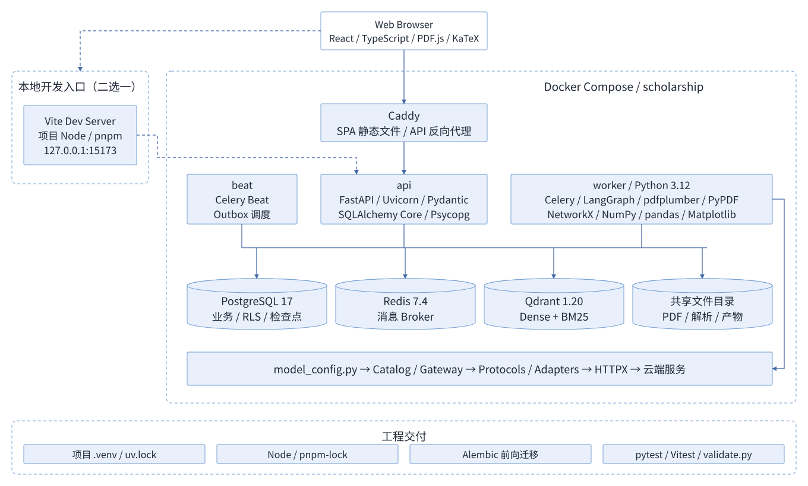

# ScholarShip 架构图集

实现基线：**2026-11-18**。五个视图分别说明协作关系、代码职责、问答执行、业务能力和运行技术。它们是当前实现的说明图，科学质量与模型样本的验证范围另见[能力说明](../guides/capabilities.md)。

## 五个视图

| 编号 | 图 | 回答的问题 | 适合的位置 |
|---|---|---|---|
| **A** | [整体架构](#a-整体架构) | 一次任务经过哪些组件？状态和结果存在哪里？ | README 架构主图 |
| **B** | [分层架构](#b-分层架构) | 页面、接口、领域、模型与基础设施如何分工？ | 代码导读、技术面试 |
| **C** | [LangGraph 工作流](#c-langgraph-工作流) | 问答的实际节点是什么？如何恢复和约束证据？ | README 的 RAG 实现说明 |
| **D** | [业务架构](#d-业务架构) | 六个模块怎样支撑阅读、核验与成果整理？ | README 能力介绍、产品演示 |
| **E** | [技术架构](#e-技术架构) | 用了哪些技术？运行进程和存储如何组织？ | 技术栈、部署说明 |

可先从 **A** 理解系统协作，再看 **C** 了解核心问答。**D** 介绍用户目标与能力地图；**B** 和 **E** 则适合对照代码或部署配置深入阅读。

## A 整体架构



[SVG](../assets/architecture/a-overall.svg) · [高清 PNG](../assets/architecture/a-overall.png) · [Mermaid 结构](../assets/architecture/a-overall.mmd)

按用户接入、接口与投递、领域执行、模型服务、数据存储分区。实线表示调用与共享资源访问，虚线表示 Outbox 的 PostgreSQL 持久化关系。PostgreSQL 保存权威业务事实，Redis 只负责投递，Qdrant 保存可重建索引，文件目录保存原件与产物。为保持主线清晰，省略结果写回和前端回读的回线。

核对入口：[问答接口](../../backend/src/scholarship/api/research.py)、[任务与 Outbox](../../backend/src/scholarship/domains/offline_workflow.py)、[投递器](../../backend/src/scholarship/workers/tasks.py)、[租约执行](../../backend/src/scholarship/workers/offline.py)。登记基础任务与补充配置/Outbox 可能分为多个事务，图中的“登记”不承诺所有步骤在单一事务提交。

## B 分层架构



[SVG](../assets/architecture/b-layered.svg) · [高清 PNG](../assets/architecture/b-layered.png) · [Mermaid 结构](../assets/architecture/b-layered.mmd)

按呈现、接口、领域、模型接入、任务执行、基础设施六类职责分层，对应真实代码目录。它表达职责划分，并非严格的逐层调用链：本地绘图无需调用模型，API 的读取操作也无需排队。Worker 和 Beat 是执行进程，共用领域代码。

核对入口：[前端](../../frontend/src/)、[接口](../../backend/src/scholarship/api/)、[领域](../../backend/src/scholarship/domains/)、[模型](../../backend/src/scholarship/models/)、[基础设施](../../backend/src/scholarship/infrastructure/)。模型接入的详细边界见[适配器设计](../models/adapter-design.md)。

## C LangGraph 工作流



[SVG](../assets/architecture/c-langgraph.svg) · [高清 PNG](../assets/architecture/c-langgraph.png) · [Mermaid 结构](../assets/architecture/c-langgraph.mmd)

中间是实际图：`START → retrieve → rerank → answer → publish → END`。两侧为节点访问的模型端口与存储，虚线表示状态检查点；PostgresSaver 使用 PostgreSQL 内的 checkpoint schema，并非另一套物理数据库。作者顺序、原生表格计算等命中后，在节点内复用确定性证据与回答；它们不是额外的图节点。证据不足的云端问答跳过生成请求，仍可发布“证据不足”的结果。`publish` 会核对引用与来源约束，原文引用仍需用户审阅。

状态经 `PostgresSaver` 同步持久化；模型调用另有请求记录、额度占用与回执。结果未知时由 Worker 转为 `waiting_user`，检查点不能替代外部请求对账。Studio 翻译、写作、图谱等由普通 Python 操作分派执行，并未统一改造成这张 LangGraph 图。

核对入口：[qa_graph](../../backend/src/scholarship/domains/offline_workflow.py)、[混合检索](../../backend/src/scholarship/domains/indexing.py)、[结构化工具](../../backend/src/scholarship/domains/structured_retrieval.py)、[模型网关](../../backend/src/scholarship/models/gateway.py)、[Worker 异常状态](../../backend/src/scholarship/workers/offline.py)。

## D 业务架构



[SVG](../assets/architecture/d-business.svg) · [高清 PNG](../assets/architecture/d-business.png) · [Mermaid 结构](../assets/architecture/d-business.mmd)

上方是工作空间入口，中间六列是业务能力，下方是共享的来源、任务和产物管理。此图表达模块归属，不表示必须顺序完成全部六模块：CSV 绘图可独立使用，成果也可以随时回到文献与原文。多篇范围接口、图谱候选和方向草稿的存在，不等于一般性科学质量或研究创新性已通过验证。

核对入口：[导航](../../frontend/src/navigation.ts)、[阅读](../../frontend/src/Reader.tsx)、[成果](../../frontend/src/Results.tsx)、[Studio 操作集合](../../backend/src/scholarship/domains/studio/workflow.py)、[发现与图谱领域代码](../../backend/src/scholarship/domains/studio/)。业务操作见[使用手册](../guides/user-manual.md)。

## E 技术架构



[SVG](../assets/architecture/e-technology.svg) · [高清 PNG](../assets/architecture/e-technology.png) · [Mermaid 结构](../assets/architecture/e-technology.mmd)

按浏览器、应用进程、共享资源与交付工具分组。容器模式通过 Caddy 提供前端与 API 反向代理，本地模式的 Vite 开发入口以虚线表示；两种应用模式互斥。本地模式下 API、Worker、Beat 也是本地进程，图中的容器边界仅用于容器应用模式。资源连接线表示整个后端对资源的共享访问，不把某个数据库单独绑定到某个进程。技术版本依据锁定依赖与 Compose 配置。

核对入口：[Python 依赖](../../pyproject.toml)、[前端依赖](../../frontend/package.json)、[Compose](../../deploy/compose.yaml)、[Caddy](../../deploy/Caddyfile)、[统一模型配置](../../model_config.py)、[验证入口](../../validate.py)。

## 编辑与复用

- **SVG**：固定版式矢量稿，保留文本，可放进 GitHub README 或导入矢量编辑器。查看设备需要中文字体；PNG 已完成字体栅格化。
- **PNG**：宽 2,400 像素的预览与演示稿，适合直接放到文档或幻灯片。
- **Mermaid**：便于 GitHub 和 Markdown 编辑的简化结构稿，语义与同编号视图对应，布局不追求与 SVG 完全相同。
- **绘制源码**：[scripts/render_architecture_gallery.py](../../scripts/render_architecture_gallery.py)。路径、字体和导出设置集中在顶部，五张图的尺寸与节点位置分别定义；使用本地 SVG 与 librsvg，不调用模型或联网服务。

重新生成固定版式：

```bash
.venv/bin/python scripts/render_architecture_gallery.py
```

PNG 导出需本机可用的 `rsvg-convert`；只需 SVG 时可在脚本顶部设 `EXPORT_PNG = False`。Mermaid 文件独立维护，脚本不会覆盖它们。

从仓库根 README 引用所选图的示例：

```markdown


```
