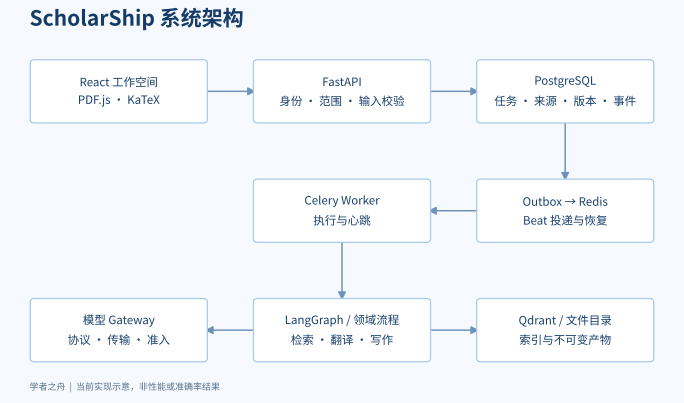
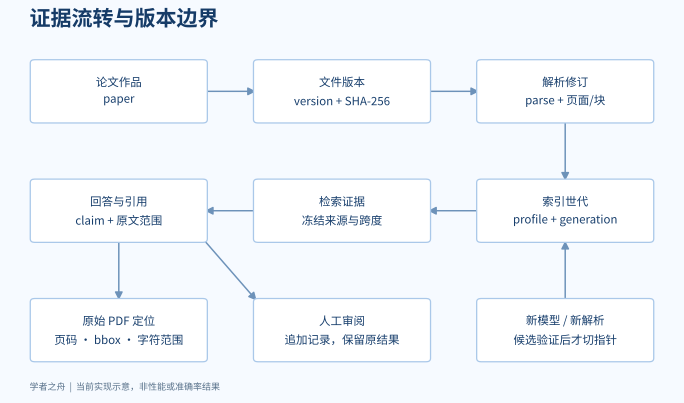
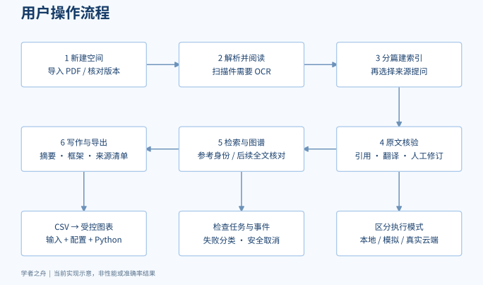

# 三张图读懂 ScholarShip

## 先看系统如何分工

前端负责操作与原文呈现，API 验证身份、来源范围和输入。PG 保存业务事实；outbox 把执行意图交给投递器和 Redis，再由 worker 处理。图中的箭头表示主依赖，后台也会持续写回 PG 状态。图上没有画出所有返回线，避免把请求图变成无法阅读的网。

Qdrant 和文件目录用途不同：前者保存可重建检索数据，后者保存原件与产物。模型 Gateway 后面可以接模拟协议或受准入约束的真实服务；这个分层不代表本地 Ollama/OCR 已实际跑通。

## 再看引用为什么不会随版本漂移

作品不是 PDF 文件，文件也不是解析结果。回答绑定使用过的版本、修订和来源跨度；重解析或换 embedding 产生新候选，核对后才发布。人工审阅保存新记录，原模型回执和原解析仍可追查。

## 最后沿操作顺序走一遍

先用独立空间练习。不要跳过解析和索引的就绪检查。生成结果后回到原文核对，最后再整理写作或图表。图表可以单独使用，不需要先进行问答。各模块操作细节见[完整手册](../guides/user-manual.md)。

图片同时提供 PNG 和 SVG，绘制源码为 `scripts/render_architecture.py`。图是实现说明，不是应用截图；没有用静态设计稿证明功能运行。
