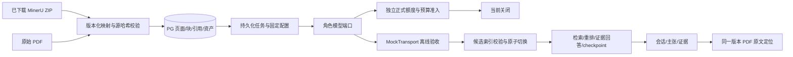

# M2 正式业务闭环设计

本批授权是开发与离线验收；不增加云端调用或上传。来源是否真实与模型是否模拟分别记录，防止把真实 PDF + 模拟回答当作真实科研结论。

| 边界 | 实现 | 约束 |
|---|---|---|
| 原生产物 | `domains/mineru_native.py` | 只接受已核验 3.4.4、完整页序、安全 ZIP、匹配的源 PDF 哈希；不解压执行文件 |
| 版本出版 | 同上 | 原 ZIP、资产、源文件哈希、原始 ordinal/bbox、映射修订固定；旧修订不改 |
| 检索 | `domains/indexing.py` | 同一项目、版本、parse、profile、世代；精确验证 PG manifest 与 Qdrant 内容后切活动指针 |
| 正式任务 | `domains/research.py` | 从项目保存的 preset/overrides 读取配置；入队固定完整模型/协议与源范围 |
| 模型端口 | `models/gateway.py`、`models/production.py` | 业务只传角色/操作/参数，不包含厂商分支 |
| 持久化问答 | `domains/offline_workflow.py` | 共用 LangGraph checkpoint、逐字引用验证及会话/主张/证据事务 |
| 产品接口 | `api/research.py` | 研究账号变更，账号 RLS 隔离，CSRF；评审账号只读本人空间 |
| 阅读器 | `frontend/src/Research.tsx`、`SourceReader.tsx` | PDF.js 原件、固定修订、目录、公式原文、表格/图片资产、PDF 坐标高亮；HTML 只显示文本 |

PDF.js 阅读器按需加载，文献列表/任务面板共用独立请求 helper；初始主包从改动初版的约 697 kB 降为约 250 kB（压缩前），进入原文阅读时才加载 PDF 模块。

## 坐标与结构

`content_list` bbox 为 0–1000 归一化的显示页坐标；与 `layout.pdf_info.page_size`、原 PDF CropBox 和旋转交叉检查。保存显示页 bbox 和绝对 PDF 用户空间 bbox；前端用当前 PDF.js 的 `convertToViewportPoint` 转为画布坐标，避免重复旋转。0/90/180/270 度与非零 CropBox 均有独立预期值测试。无法确认尺寸、页序、UserUnit 或版本时拒绝发布。

标题保留原生层级；如标题有 `3.2.2` 等明确编号，另以 `numeric-section-depth-v1` 建立树，原生值仍保存在 `structured_json.native_heading_level`。这不是作者、机构或语义结构识别的完成证明。参考文献条目保留全文并设为 unresolved；不猜 DOI 或作者。

`combine_parts` 验证每份产物对应精确 PDF 页段、每段不超过 200 页、全局完整且不重叠。组合包保留原 ZIP、各段哈希和全局页序；图片同名不同内容拒绝合并。541 页用独立生成的空白 PDF/文字夹具验证三段合并与第 541 页入库，不上传实际教材，不声称教材 OCR 质量通过。

## 模拟与真实隔离

- `offline_acceptance`：真实 OCR 来源，明确模拟的向量/重排/回答。全部请求由 `httpx.MockTransport` 响应；不会加载 Key 或使用真实 HTTP transport。模拟 profile 含 `simulated=true`。
- `cloud`：同一业务流程，使用 `ProductionGateway`，返回真实回执。当前总开关关闭且没有生产策略；API 会拒绝准入。
- `mock`、`local`、`free_api`、`free_gemma` 可以用于离线协议验收；选择 local 不证明模型安装、OCR 服务可用或本地推理完成。
- 模型替换只影响新任务。已有 checkpoint 继续用固定的协议/型号；变更向量化配置需要新 profile/世代。历史 models-v1 和旧迁移保留。新建索引任务在 run_steps 内原子登记世代：切回旧模型创建新世代并校验后切换，旧任务只恢复自己的世代，不能在重放时回滚较新的活动索引。
- 真实 profile 只能由同 owner/project 的成功、已消耗授权请求或正式准入回执登记；校验角色、模拟位、维度、型号、地址、协议和输入策略。登记证明模型身份/维度，不证明整篇已有向量。
- `real_profile_proofs` 保存项目级回执来源；全局语义 profile 可复用，但新项目仍须拥有证明，不能仅知道 profile ID 就绕过准入。

## 正式额度与预算

0009 新建独立生产策略/占额表及证明表，0010 补齐没有专属输入前缀的协议兼容。没有新增或修改 41 张业务表；没有扩大一次性 grant。

正式调用须同时满足：当前配置允许云端、外部服务总开关、明确免费且启用的 owner/project/provider/model/role 策略、有效期、请求/Token 余额、共享预算池 live gate、账号预算。策略只有管理员维护权限，迁移不创建策略，工作台不能启用它。收费路线没有已审核价格时不支持执行。

发包前的一个数据库事务锁定策略与调用，预占一次请求、保守 Token 上界，并调用现有共享/账号预算。免费请求用 **0.000001 CNY 安全预留**接入预算门禁，这不是 Token 单价；成功且 usage 完整后按 0 CNY 结算。缺失 usage、超时、异常回执、429 均保留占额，任务进入 waiting_user；不会重发、退款、重置或自动换供应商。安全预留不构成供应商账单硬上限。

同一 run/intent/请求哈希可复用成功回执；参数不同冲突。已发送但未知的调用不重发，结果落库确认丢失也从已保存回执恢复。HTTP 保持 TLS 验证、禁止重定向与自动重试；密钥只在通过门禁后注入请求头。

本批没有生产启用维护入口，也没有人工对账自动化。启用额度、补充真实语料、实际问答效果和下一阶段模块都需另外评审。
