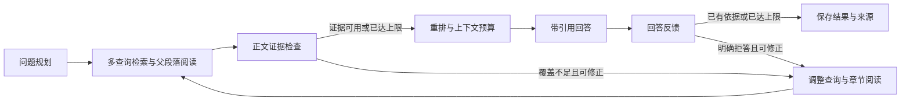

# 正文检索与有界反馈

2026-11-24。修复“索引写入完成，但给回答模型的证据主要是标题、编号与短碎片”的问题。接口成功、向量点数与模型可用性，不等于研究问答质量通过。

## 数据准备

`local-regions-ocr-v3` 在本地文字层解析中允许正文行的轻微坐标重叠，并用页面文字高度辅助归并上下标，保留列之间的边界。页边短文本标为其他内容，章节信息随原文块保存。文字层可读取时仍使用文字层，不把检索失败误报成 OCR 失败。

新解析的检索入口过滤独立标题、编号和缺少正文信息的短块，继续使用原有逐字窗口与来源跨度格式。父段落可作为检索命中的补充上下文，不拼接不同原文块冒充一条逐字证据。公式、阅读顺序及复杂版面仍需核对；词数规则是噪声检查，不是语义理解或科学质量认证。

旧解析、旧索引、历史回答和失败调用均保留。新任务使用新修订，历史任务不会被重写。界面发现历史会话绑定旧索引时，会提示用户使用最新资料新建对话，避免把不同版本的上下文混在一起。

## 问答流程

新本地问答固定 `RESEARCH_QA_POLICY` 快照，执行带检查点的条件图：

- 问题规划采用明确的科研意图词表，将目标、贡献、方法、实验、局限等问题展开为英文检索词；这不是通用中文翻译，也不生成未经原文支持的论文事实。
- 中文原问题与英文展开共同执行向量/BM25检索，保留每个查询的召回轨迹；结果按查询轮流合并，过滤标题噪声，扩展精确父段落并去重。综合性问题补充按章节阅读的原文证据。
- 重排最多 20 条候选，回答最多 8 条证据，总上下文默认上限 8,000 字节。章节工具读取原文，不把模型推测作为新证据。
- 默认最多两轮。正文数量不足，或模型明确返回有效的 `insufficient_evidence=true`，才进入修正；达到上限仍不足则保留拒答。未知网络结果、调用契约错误或准入失败沿用暂停/失败处理，不作为重新发送模型请求的许可。
- 作者序号提取、原生表格计算等已有确定性工具保留。回答继续采用逐字来源引用契约；引文能定位不等于全部科研判断已验证。

实时任务事件展示问题规划、当前检索轮次、重排、回答以及是否进入修正。完整策略、候选数量、证据检查和回答反馈保存在结果的 `trace` 中。旧任务继续使用原先固定的流程。

## 引用生成契约

新本地问答固定 `quote-menu-v2`。模型只看到本批次的短编号 `e0、e1…`，生成 schema 将每个证据编号与其合法 `q0、q1…` 菜单配对约束；服务端再通过确切映射恢复原证据身份和原文字符跨度。提示词不再要求复制包含来源 UUID 与前缀的长编号。旧任务继续采用其原契约，不推断或补造缺失的编号，不把不合格引用静默丢掉后冒充有效回答。

该修复来自一次真实失败：模型在最后一条引用中漏写了证据 ID 的前缀，导致整份回答未通过校验。用户明确要求重跑后，用新契约创建替代任务并保留原失败及调用诊断；原问题成功获得中文回答与 7 条逐字定位引用。新任务的向量、重排、回答调用均成功，未新增云端调用。此次成功不能保证任意问题或未来服务故障永不报错。

## 验证范围

`backend/tests/test_adaptive_qa.py` 覆盖重叠正文行、跨列边界、碎片过滤、来源跨度、拒答后的单轮修正、达到上限后停止、检查点恢复及未知调用不重发。

一次本地真实回归对原来拒答的同一篇 14 页论文重新解析和建索引：791 个索引点变为 147 个正文检索片段，独立标题和少于 30 字符的片段均为 0。两条原始中文问题分别获得 5 条和 7 条引用，英文展开的 BM25 召回不再为零；引用字符跨度与保存的原文一致，并人工核对了两份样例概述及实验任务清单。

这两条真实问题在第一轮即可回答；修正分支通过离线故障注入验证，不能表述为真实样例都触发过自我修正。另一篇当前空间文献的索引也已更新，但没有据此宣称其全部问答质量通过。机器记录与原始内容保存在忽略目录 `var/reports/`，不进入 Git。
